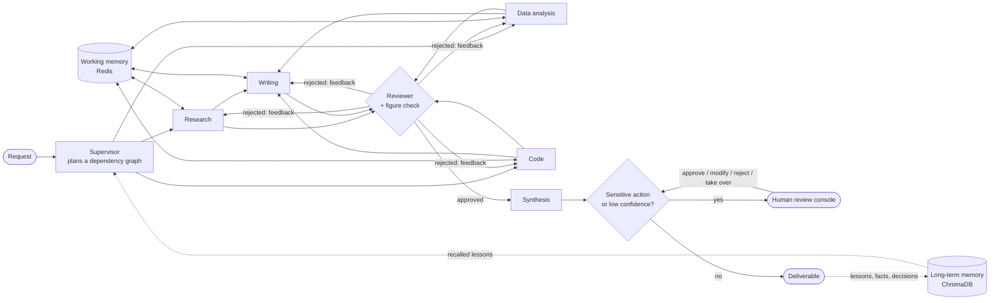

# Agent Orchestration System

A multi-agent orchestration system where AI agents decompose complex tasks, use tools to execute them, learn from past interactions via persistent memory, and escalate to humans when confidence is low. It is not an AI demo: it is production infrastructure for autonomous AI workflows, with every decision traced, costed and replayable.



## What it does

- **Plans.** A supervisor turns a request into a validated dependency graph of subtasks, each owned by a specialist: research, data analysis, writing or code. Independent subtasks run in parallel.
- **Uses tools.** Specialists call web search, an HTTP fetcher, a read-only SQL tool, a Python runner, workspace files and tools from MCP servers, all through one registry that checks permissions, rate limits and arguments and logs every call.
- **Checks its own work.** A reviewer scores every output against its expected format and the tool results the specialist saw. Numbers that appear in no tool result are rejected automatically, whatever the model thinks.
- **Remembers.** Each finished run leaves an episode record plus lessons, facts and preferences in ChromaDB. The next similar task recalls them, the planner cites the ones it used, and repeated lessons are merged and fade when unused.
- **Asks a human.** Low plan confidence, repeated failures, poor reviews, sensitive actions such as sending email, or an explicit request pause the run durably. A reviewer approves, edits, rejects or takes over from a Streamlit console and can question the agents first.
- **Shows its working.** Every node, model call, tool call, memory lookup and escalation is an OpenTelemetry span, stored in Postgres and drawn as a tree with prompts, tokens, latency and cost.
- **Replays.** Any finished run can be re-run from its recorded model answers. Edit one answer and the replay shows exactly where the run diverged and what changed downstream.

## Quick start

Docker with Compose v2 is the only requirement. Everything runs on scripted mock models by default, so no API keys are needed.

```bash
docker compose up -d --build --wait
docker compose exec api python scripts/seed.py
docker compose exec api python scripts/demo.py --auto-approve
```

Then open the console at http://localhost:8501. The demo asks the agents to research three vector databases, compute a comparison from a benchmark table, write an executive summary and email it to the team. Along the way the plan is shaped by seeded memories, the reviewer rejects a draft that misquotes a figure, and the email waits for approval. Leave out `--auto-approve` to approve it yourself in the Review queue.

| Service | Port |
|---|---|
| Review console (Streamlit) | 8501 |
| API (FastAPI, docs at `/docs`) | 8000 |
| Postgres / Redis / ChromaDB | 5433 / 6380 / 8001 |
| Jaeger (`docker compose --profile observability up`) | 16686 |

### Without Docker

```bash
uv sync
STORAGE_MODE=memory uv run python -m aos run "What is retrieval-augmented generation?" --sync --auto-approve
```

`STORAGE_MODE=memory` swaps Postgres, Redis and the Chroma server for SQLite, fakeredis and an in-process Chroma, so nothing else needs to run. With the infrastructure containers running (`docker compose up -d postgres redis chromadb`), start the API with `uv run uvicorn aos.api.main:app`, a worker with `uv run celery -A aos.worker.celery_app worker -Q aos` (add `--pool=solo` on Windows) and the console with `uv run streamlit run ui/Home.py`.

### Real models

Set `LLM_MODE=live`. `config/models.yaml` lists a provider chain for each role, and providers without an API key are skipped:

- **Local, no keys:** install [Ollama](https://ollama.com), run `ollama pull qwen2.5:7b`, and every role uses it. The native Ollama API is used so the context window (`OLLAMA_NUM_CTX`, default 8192) and temperature can be set.
- **Hosted:** set `ANTHROPIC_API_KEY` and, for an OpenAI reviewer, `OPENAI_API_KEY` with `OPENAI_REVIEWER_MODEL`. Add their per-token prices to `config/pricing.yaml` to see costs.

Copy `.env.example` to `.env` to change any setting.

## Design decisions

| Decision | Why |
|---|---|
| LangGraph state machine with a Postgres checkpointer | Pausing for a human is an `interrupt()` that survives restarts; a different worker process resumes the run. |
| Specialists propose side effects, a separate node runs them | Approval sits between proposal and execution, so nothing has to be undone and agents are never re-run to apply a decision. |
| Deterministic guards around model judgment | Small models make predictable mistakes. Code enforces the parts that must hold: which tools a request allows, who may receive email, that cited figures exist, that dependencies named in a plan are wired up. |
| Reviewer sees the specialist's tool results | It checks figures against evidence instead of guessing; this alone turned wrong answers from a 7B model into right ones. |
| Replay from recorded calls, not checkpoint surgery | Calls are matched by position (agent, purpose, subtask, attempt, turn) and reused while the prompt is unchanged. It is deterministic, costs nothing for unchanged steps, and reports the first divergence. |
| Offline hash embeddings by default | Tests and the demo need no model download; semantic embeddings from Ollama or OpenAI are one setting away. |
| The UI only talks to the API | The Streamlit console can be replaced without touching the backend. |
| Scripted mock models | Every test, the CI run and the demo are deterministic and free. |

More detail is in [docs/ARCHITECTURE.md](docs/ARCHITECTURE.md).

## Tests

```bash
uv run pytest -q                    # 148 unit and end-to-end tests, in-process, about 90 s
uv run pytest -q -m e2e --services  # the end-to-end suite against the running Docker stack
```

The end-to-end suites drive the system only through its HTTP API: plans form valid dependency graphs, specialists stay within their tools, the reviewer catches a misquoted figure, a repeated task plans better from memory, each escalation trigger pauses at the right level, and runs recover from tool failures, repeated failures, model outages and restarts. CI runs lint and the in-process suite on every push.

## Live results on a local 7B model

On `qwen2.5:7b` with no API keys, the question "which vector database has the lowest p95 latency and which is cheapest per month?" went from a wrong answer, six reviewer rejections and two unrequested emails to an invented address in 3 minutes 13 seconds, to the correct answer with no rejections and no email in 45 seconds. The changes that did it were the context window, the reviewer seeing tool results, the automatic figure check, dependency inference for plans, and a request-gated email policy.

## Limitations

- `code_exec` runs Python in a subprocess with a stripped environment and a timeout. It is not a sandbox; untrusted code needs gVisor or Firecracker.
- There is no authentication; the API and console assume a trusted network.
- The default embedder matches shared vocabulary, not paraphrases.
- Hosted-model prices are not shipped and must be added to `config/pricing.yaml`.
- The application image is about 2.8 GB, mostly ChromaDB's ONNX runtime and Streamlit.

## Project layout

```
src/aos/
  agents/         supervisor, specialists, reviewer, prompts
  llm/            providers (Anthropic, OpenAI, Ollama, mock), routing, call recording
  tools/          registry, built-in tools, MCP adapter, sensitive-action policy
  graph/          LangGraph nodes, routing, runner, checkpointer
  memory/         working memory, long-term memory, retrieval, scoring, maintenance
  hitl/           escalation policy, approval queue, notifications, reviewer chat
  observability/  tracing, span exporter, costs, metrics
  replay/         recorded-call replay and run comparison
  api/            FastAPI routes
  worker/         Celery tasks
ui/               Streamlit console
config/           models, tools, MCP servers, escalation levels, pricing
scripts/          seed and demo
tests/            unit, e2e, fixtures (mock model scripts, benchmark data)
```
