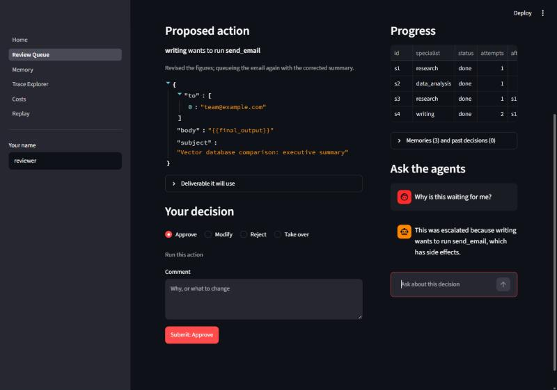
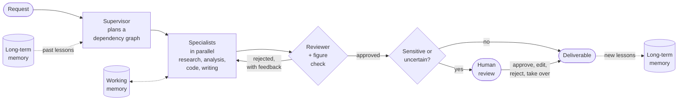
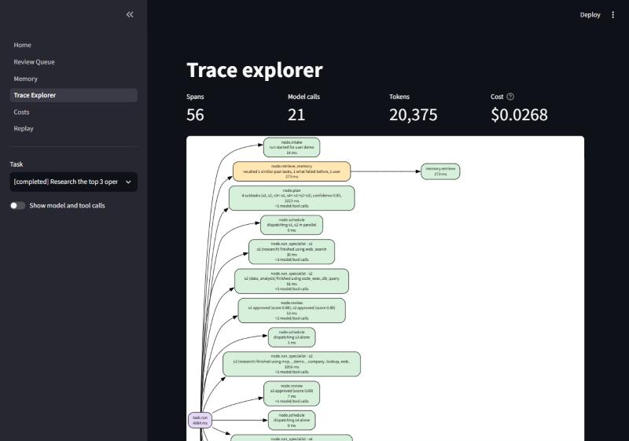
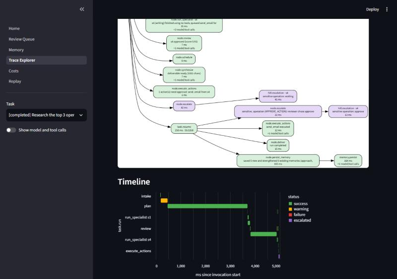
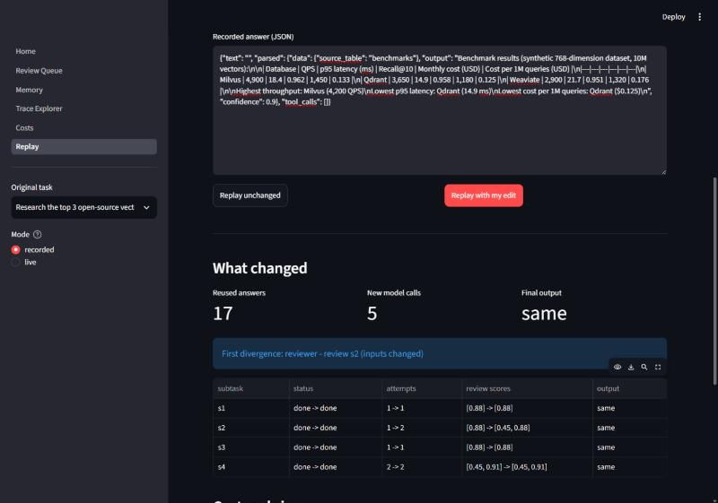
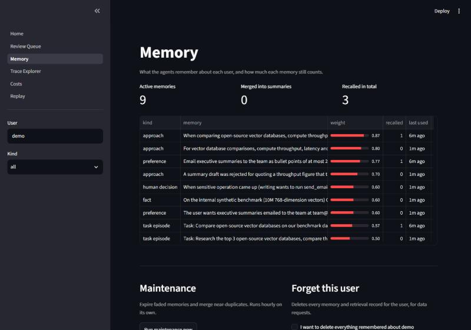

# AOS

A multi-agent system that takes a request in plain English, plans it as a graph of subtasks, and hands those to specialist agents (research, data analysis, code, writing) that use tools to do the work. A reviewer agent checks every result against the tool output it was based on. Lessons from finished tasks are remembered for the next similar one. When an agent wants to do something with side effects, or the system isn't sure, it stops and asks a person.

Runs on scripted mock models out of the box, or on a local Ollama model. No API keys needed.

[](https://github.com/pentiumcoder/AOS/actions/workflows/ci.yml)


Measured on a laptop with `qwen2.5:7b`. The benchmark table the agents query is synthetic and I wrote the demo tasks myself, so take these as best-case numbers; see [Known limitations](#known-limitations).

| | |
|---|---|
| Focused data question answered correctly | 3 of 3 runs |
| Same question, third run vs first (memory from earlier runs) | 37 s vs 79 s, 13 vs 26 model calls |
| System overhead per run, mock models | 1.6 s median |
| Replaying a finished run from its recordings | about 1 s, no model calls |



The writing agent wants to email a summary, so the run has paused. The review queue shows the proposed email, the state of every subtask and the memories the plan used, and you can ask the agents about the step before approving, editing, rejecting or taking over.

## Why I built it

Agents that call tools are easy to demo and hard to trust. On a small local model, the first version of this answered a simple question about a benchmark table with the wrong database, had its drafts rejected six times, and sent two emails nobody asked for to an address it made up. Most of those mistakes are predictable: numbers that don't appear in any tool result, recipients that don't exist, steps that use another step's output without waiting for it.

So the rules that have to hold are checked in code rather than left to the model, anything with side effects waits for a person, and every step is recorded so a run can be inspected and replayed afterwards. The [architecture notes](docs/ARCHITECTURE.md) go into the details.

## How it works



The supervisor turns the request into subtasks with dependencies, checks the plan for cycles and missing links, and fills in dependencies the model named but forgot to declare. LangGraph runs every subtask whose dependencies are done in parallel. Specialists can search the web, fetch URLs, run read-only SQL and Python, use workspace files and call tools from MCP servers, all through one registry that checks permissions, arguments and rate limits.

The reviewer sees the same tool results the specialist did. Any number in an answer that doesn't appear in those results gets the answer rejected, whatever score the reviewer model gave it. Rejected work goes back with feedback, failed work is retried with a different approach, and after two tries it goes to a person.

When a task finishes, a summary of the run and any lessons go into ChromaDB. The next similar task recalls them, and the planner has to say which ones it used. A run pauses for a person on a shaky plan, repeated failures, low review scores, side effects like sending email, or when the user asked to review the result. The pause is a LangGraph `interrupt()` backed by a Postgres checkpoint, so it survives restarts and any worker can resume it.

Every node, model call, tool call and escalation is an OpenTelemetry span stored in Postgres. Replay re-runs a finished task using the recorded model answers, reusing each one as long as its prompt hasn't changed, so you can edit one answer and see exactly where the run goes differently.

## Running it

With Docker:

```bash
git clone https://github.com/pentiumcoder/AOS.git && cd AOS
docker compose up -d --build --wait
docker compose exec api python scripts/seed.py
docker compose exec api python scripts/demo.py
```

Then open <http://localhost:8501> and set **User** in the sidebar to `demo`. The demo asks for a comparison of three vector databases from a benchmark table, a summary, and an email to the team. It stops when the email needs approval; approve it in the Review queue, or pass `--auto-approve` to let the script do it. The API is at <http://localhost:8000/docs>.

The first build took about 8.5 minutes on my machine. The images come to about 4 GB, and the running stack uses about 0.9 GB of RAM.

Without Docker, you need Python 3.11 and [uv](https://docs.astral.sh/uv/):

```bash
uv sync
STORAGE_MODE=memory uv run python -m aos run "What is retrieval-augmented generation?" --sync --auto-approve
```

`STORAGE_MODE=memory` swaps Postgres, Redis and the Chroma server for SQLite, fakeredis and an in-process Chroma, so nothing else has to run.

To use real models, set `LLM_MODE=live` in `.env`. With no keys it runs everything on Ollama (`ollama pull qwen2.5:7b`, about 8 GB of VRAM). Set `ANTHROPIC_API_KEY` or `OPENAI_API_KEY` to use hosted models instead. All settings are listed in [.env.example](.env.example).

You can also drive it over the API:

```bash
curl -s localhost:8000/tasks -H 'Content-Type: application/json' \
  -d '{"request": "Compare our vector databases by p95 latency", "user_id": "demo", "require_human_review": true}'
```

## Results

With mock models, which answer instantly, these numbers are the system's own overhead. The demo task (20 model calls, 6 tool calls, one approval) took 1.6 s median and 4.1 s p95 over 10 runs; the p95 is mostly the first, cold run. Pushing 24 tasks through with 8 in flight gave 57 runs a minute on one worker and 113 on three. Three workers only doubled it because every run writes to the same Postgres. Reading a task or its trace takes 6 to 15 ms.

On `qwen2.5:7b`:

| task | run | time | model calls | tokens | human steps |
|---|---|---|---|---|---|
| "Which vector database has the lowest p95 latency and which is cheapest per month?" | 1 | 79 s | 26 | 27.5k | none |
| | 2 | 53 s | 23 | 23.8k | none |
| | 3 | 37 s | 13 | 12.9k | none |
| Demo task: research, compare, summarise, email | 1 | 291 s | 47 | 81.3k | 4 approvals after low review scores |
| | 2 | 333 s | 27 | 54.8k | 1 approval, 1 takeover after a subtask failed twice |

The focused question came back right every time (Qdrant at 14.9 ms, pgvector at $760 a month), though in two bullets when I'd asked for three. It was the same user each time, so later runs had the earlier runs' lessons, and by the third run time and model calls had halved.

The demo task is too open-ended for a 7B model. Both runs finished, but only because a person stepped in: one run's research named a database that doesn't exist, the other listed FAISS and Annoy (libraries) as databases, and the writer never got as far as proposing the email. The checks caught the bad work and handed it to a person, which is the point, but this kind of task needs a bigger model.

What the guardrails changed, on the focused question:

| | before | after |
|---|---|---|
| time | 3 min 13 s | 45 s |
| reviewer rejections | 6 | 0 |
| right answer | no | yes |
| unrequested emails | 2 | 0 |

The fixes were an 8192-token context window, giving the reviewer the tool results, checking figures in code, filling in plan dependencies the model forgot, and only offering email when the request asks for it.

To reproduce the timings, run `uv run python scripts/bench.py --runs 10 --tasks 24 --parallel 8` against a fresh stack.

## Known limitations

- **The demo data is easy.** The benchmark table is synthetic and I wrote the demo tasks, so the questions line up neatly with the data. Real requests would do worse.
- **A 7B model can't do open-ended research.** Focused questions over the database work; the full demo task needed a person in both live runs.
- **Web search is weak without a key.** Without `TAVILY_API_KEY` it uses DuckDuckGo, which rate-limits and returns short snippets.
- **No authentication.** Keep it on a trusted network.
- **`code_exec` is not a sandbox.** It runs model-written Python with a timeout and without API keys, but as the same user as the worker and with network access. Don't let untrusted users submit tasks.
- **Email isn't sent.** `send_email` writes to an `outbox` table.
- **History grows forever.** The cross-run summary recomputes from raw rows (158 ms with 35 runs), and spans, prompts and responses are never cleaned up.
- **The default embedder matches words, not meaning.** Switch `EMBEDDING_PROVIDER` to `ollama` or `openai` for semantic recall.
- **Hosted model prices aren't included**, so those calls show as unpriced until you add them to `config/pricing.yaml`.

## Screenshots

The trace for the demo run, with each node's decision and timing. Every node expands into its model and tool calls:



The same run after the pause: the escalation, the resume once the email was approved, and a timeline of where the time went:



Replaying the run with one recorded answer edited to quote 4,900 QPS instead of 4,200. The reviewer rejects it because no tool result contains that number, the specialist retries, and the final output comes out the same:



What the agents remember about a user, and how much each memory still counts:



## Project layout

```
src/aos/
  agents/         supervisor, specialists, reviewer, prompts
  llm/            Ollama, Anthropic, OpenAI and mock providers, routing, call recording
  tools/          registry, built-in tools, MCP adapter, sensitive-action policy
  graph/          LangGraph nodes, routing, runner, checkpointer
  memory/         working and long-term memory, retrieval, scoring, maintenance
  hitl/           escalation policy, approval queue, notifications, reviewer chat
  observability/  tracing, span exporter, costs, metrics
  replay/         recorded-call replay and run comparison
  api/            FastAPI service
  worker/         Celery tasks
ui/               Streamlit console
config/           models, tools, MCP servers, escalation levels, pricing
scripts/          seed, demo and benchmark
mcp_servers/      demo MCP server
tests/            unit and end-to-end tests, mock model scripts, demo data
docs/             architecture notes, screenshots
```

## Development

```bash
uv run ruff check . && uv run ruff format --check .
uv run pytest -q                              # 150 tests, offline, mock models
uv run pytest -q -m e2e --services            # end-to-end tests against the running stack
```

The normal test run uses mock models, SQLite and fakeredis, so it needs no network, no GPU and no services. The end-to-end tests only go through the HTTP API. CI runs lint and the full test suite on every push.

## License

[MIT](LICENSE)
