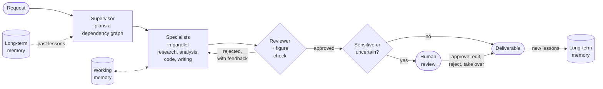

# Agent Orchestration System

[](https://github.com/pentiumcoder/AOS/actions/workflows/ci.yml)


AOS takes a request in plain English, splits it into subtasks and hands them to specialist agents (research, data analysis, code, writing) that use tools to get the work done. A reviewer agent checks each result before it is used. Lessons from finished tasks are stored and recalled the next time a similar task comes in, and anything risky or uncertain waits for a person to approve it. Every step is traced, so a run can be inspected, costed and replayed afterwards.

It is built on LangGraph, FastAPI, Celery, Postgres, Redis, ChromaDB and Streamlit, and runs on Anthropic, OpenAI or a local Ollama model. Scripted mock models let you run all of it without any API keys.



## What it does

- The supervisor turns a request into a dependency graph of subtasks. Subtasks that don't depend on each other run in parallel.
- Specialists can search the web, fetch URLs, run read-only SQL, run Python, read and write workspace files, and call tools from MCP servers. Every call goes through one registry that checks permissions, arguments and rate limits, and logs it.
- The reviewer sees the same tool results the specialist saw. An answer containing a number that appears in none of them is rejected, regardless of the review score.
- When a task finishes, a record of the run and any lessons learned go into ChromaDB. The planner is given the relevant ones next time and has to say which it used. Similar lessons are merged over time and unused ones fade out.
- A run pauses for a person when the plan looks shaky, a subtask keeps failing, a review score stays low, an agent wants to do something with side effects such as sending email, or the user asked to review the result. The pause survives restarts. From the console, a reviewer can approve, edit, reject or take over, and can ask the agents about the step first.
- Each graph node, model call, tool call, memory lookup and escalation is recorded as an OpenTelemetry span in Postgres. The console draws them as a tree with prompts, responses, tokens, latency and cost.
- A finished run can be replayed from its recorded model answers. Change one answer and the replay shows where the run went differently.

## Quick start

You need Docker with Compose v2. Mock models are the default, so no keys are needed.

```bash
docker compose up -d --build --wait
docker compose exec api python scripts/seed.py
docker compose exec api python scripts/demo.py --auto-approve
```

Open the console at http://localhost:8501 and set **User** in the sidebar to `demo`. The demo asks for a comparison of three vector databases using a benchmark table, a short summary, and an email to the team. You'll see the plan use two seeded memories, the reviewer reject a draft with a wrong figure, and the email wait for approval. Leave out `--auto-approve` to approve it yourself on the Review queue page.

| Service | Port |
|---|---|
| Review console (Streamlit) | 8501 |
| API (FastAPI, docs at `/docs`) | 8000 |
| Postgres / Redis / ChromaDB | 5433 / 6380 / 8001 |
| Jaeger (`docker compose --profile observability up -d`) | 16686 |

### Requirements

| | Needed | On the test machine |
|---|---|---|
| Disk | about 5 GB for images | app image 2.8 GB, Postgres, Redis and ChromaDB images 1.3 GB |
| Memory | 2 GB free | 0.9 GB idle, 1.7 GB peak with three workers under load |
| First build | | about 8.5 minutes with an empty Docker cache |
| Live mode (optional) | Ollama, and a GPU with 8 GB of VRAM for `qwen2.5:7b` | RTX 4070 Laptop, 8 GB |

### Without Docker

You need Python 3.11 and [uv](https://docs.astral.sh/uv/).

```bash
uv sync
STORAGE_MODE=memory uv run python -m aos run "What is retrieval-augmented generation?" --sync --auto-approve
```

`STORAGE_MODE=memory` uses SQLite, fakeredis and an in-process Chroma instead of the servers, so nothing else has to be running. To run the full set of processes locally, start the infrastructure with `docker compose up -d postgres redis chromadb`, then the API with `uv run uvicorn aos.api.main:app`, a worker with `uv run celery -A aos.worker.celery_app worker -Q aos` (add `--pool=solo` on Windows) and the console with `uv run streamlit run ui/Home.py`.

### Real models

Set `LLM_MODE=live` in `.env` and restart the stack. `config/models.yaml` lists which providers each agent tries, in order, and any provider without an API key is skipped.

For a local model with no keys, install [Ollama](https://ollama.com) and run `ollama pull qwen2.5:7b`. Every agent will use it. AOS talks to Ollama's own API rather than its OpenAI-compatible one so it can set the context window (`OLLAMA_NUM_CTX`, 8192 by default) and the temperature.

For hosted models, set `ANTHROPIC_API_KEY`, and `OPENAI_API_KEY` with `OPENAI_REVIEWER_MODEL` if you want an OpenAI reviewer. Add their per-token prices to `config/pricing.yaml` to get costs.

## Configuration

Settings are read from `.env`; copy `.env.example`, which lists all of them. The ones you're most likely to change:

| Variable | Default | What it does |
|---|---|---|
| `LLM_MODE` | `mock` | `live` calls the providers in `config/models.yaml` |
| `OLLAMA_MODEL`, `OLLAMA_NUM_CTX` | `qwen2.5:7b`, `8192` | local model and its context window |
| `STORAGE_MODE` | `services` | `memory` runs without Postgres, Redis or a Chroma server |
| `TASK_EXECUTION` | `celery` | `inline` runs tasks inside the API process |
| `EMBEDDING_PROVIDER` | `hash` | `ollama` (with `EMBEDDING_MODEL`, e.g. `nomic-embed-text`) or `openai` for recall by meaning |
| `PLAN_CONFIDENCE_THRESHOLD` | `0.6` | plans below this need approval; below `PLAN_NOTIFY_THRESHOLD` (0.75) the reviewer is notified |
| `REVIEW_APPROVE_SCORE`, `MAX_REVISIONS`, `MAX_ATTEMPTS` | `0.7`, `2`, `2` | pass mark, revisions per subtask, attempts before a person takes over |
| `TAVILY_API_KEY` | | web search through Tavily; DuckDuckGo is used if it's empty |
| `NOTIFY_WEBHOOK_URL` | | gets a JSON POST for every escalation |
| `OTEL_EXPORTER_OTLP_ENDPOINT` | | also sends traces to Jaeger or another OTLP collector |

Escalation levels are set per trigger in `config/escalation.yaml`. Tool permissions and the list of people email can go to are in `config/tools.yaml`, and MCP servers in `config/mcp_servers.yaml`.

## API

The console only uses these endpoints. Full docs are at http://localhost:8000/docs.

| Endpoint | Use |
|---|---|
| `POST /tasks`, `GET /tasks`, `GET /tasks/{id}` | submit a request, list tasks, follow a run |
| `GET /escalations`, `GET /escalations/{id}` | the review queue, and the context for one item |
| `POST /escalations/{id}/decision`, `POST /escalations/{id}/chat` | approve, modify, reject or take over; ask the agents about the step |
| `GET /users/{id}/memories`, `DELETE /users/{id}/memories`, `POST /memory/maintenance` | look at, delete and tidy long-term memory |
| `GET /runs/{id}/trace`, `GET /spans/{id}` | the span tree, and one span with its prompt, response or tool output |
| `GET /runs/{id}/metrics`, `GET /metrics/summary` | cost, tokens, latency and escalations for one run or across runs |
| `GET /runs/{id}/steps`, `POST /runs/{id}/replay`, `GET /runs/{a}/compare/{b}` | recorded steps, replay with edits, compare two runs |
| `GET /health` | database, Redis and model mode |

## Performance

All numbers come from one laptop: Intel Core i9-14900HX, 32 GB RAM, RTX 4070 Laptop GPU (8 GB), Windows 11 with Docker Desktop on WSL 2 (32 CPUs and 15.5 GB given to Docker), and Ollama serving `qwen2.5:7b`. They were measured through the HTTP API on a freshly started stack with one worker (two processes) unless noted.

### With mock models

Mock models reply instantly, so these numbers show the overhead of the system itself: running the graph, writing to Postgres, exporting spans, looking up memory and queueing.

| | Result |
|---|---|
| Showcase task end to end (20 model calls, 6 tool calls, 1 approval) | 1.6 s median, 4.1 s p95, 10 runs |
| Throughput, 24 tasks with 8 in flight, 1 worker | 57 runs/min |
| Same load, 3 workers | 113 runs/min |
| `GET /tasks?limit=20` / `GET /tasks/{id}` | 6 / 11 ms median, 7 / 15 ms p95 |
| `GET /runs/{id}/trace` / `GET /runs/{id}/metrics` | 9 / 13 ms median, 12 / 15 ms p95 |
| `GET /metrics/summary` with 35 runs stored | 158 ms median, 259 ms p95 |
| Replaying a finished showcase run | 0.5 s, 19 recorded answers reused, no model calls |
| Test suite, 150 tests | 84 s |

The p95 for single runs includes the first, cold run. Going from one worker to three only doubled throughput, because every run writes its checkpoints, spans and call records to the same Postgres behind the same API.

### With a local 7B model

| Task | Run | Time | Model calls | Tokens | Human steps |
|---|---|---|---|---|---|
| "Which vector database has the lowest p95 latency and which is cheapest per month?" | 1 | 79 s | 26 | 27.5k | none |
| | 2 | 53 s | 23 | 23.8k | none |
| | 3 | 37 s | 13 | 12.9k | none |
| Showcase task: research, compare, summarise, email | 1 | 291 s | 47 | 81.3k | 4 approvals after low review scores |
| | 2 | 333 s | 27 | 54.8k | 1 approval, 1 takeover after a subtask failed twice |
| Replaying any of the five runs above | | 0.6 to 1.1 s | none (12 to 46 reused) | 0 | none |

The focused question got the right answer every time (Qdrant at 14.9 ms, pgvector at $760 a month), though as two bullet points when three were asked for. The same user asked all three times, so each run could draw on the lessons from the runs before it. By the third run, time and model calls had roughly halved.

The showcase task is too open-ended for a 7B model to do alone. Both runs finished, but only after a person stepped in. In one run the research step named a database that doesn't exist; in the other it listed FAISS and Annoy, which are libraries, as databases. The reviewer rejected eight drafts in the first run, and the writer never got as far as proposing the email. The checks caught the weak work and sent it to a person, but for this kind of task you want a bigger model.

On the same model, before the guardrails were in place, the focused question took 3 min 13 s, drew six reviewer rejections, named the wrong database and sent two unrequested emails to an address the model made up. Five changes fixed that: an 8192-token context window, giving the reviewer the tool results, checking figures in code, filling in plan dependencies the model left out, and only allowing email when the request asks for it.

### Running the benchmark

```bash
uv run python scripts/bench.py --runs 10 --tasks 24 --parallel 8
docker compose up -d --scale worker=3 --wait
uv run python scripts/bench.py --runs 1 --tasks 24 --parallel 8 --skip reads replay
```

`scripts/bench.py` submits tasks through the API, approves anything that escalates, and prints run times, throughput, read latency and replay time. Use a fresh stack, since stored memories change the plans and therefore the numbers.

## Why it's built this way

- LangGraph with a Postgres checkpointer: waiting for a person is an `interrupt()` that survives restarts, and any worker can pick the run back up.
- Agents only propose side effects, and a separate step carries them out after approval. Nothing has to be undone, and agents don't have to run again once a decision is made.
- Some rules are enforced in code because small models break them in predictable ways: which tools a request allows, who can receive email, whether quoted figures exist, and whether the plan's dependencies are wired up.
- The reviewer gets the specialist's tool results, so it checks figures against the data instead of guessing. This made a large difference on the 7B model.
- Replay reuses recorded model calls instead of forking checkpoints. Calls are matched by agent, subtask, attempt and position, and reused as long as the prompt is unchanged, so unchanged steps cost nothing and the first change is easy to find.
- Embeddings default to a simple hash so tests and the demo don't need to download a model. Ollama or OpenAI embeddings are one setting away.
- The console only talks to the API, so it can be replaced without touching the backend.
- Scripted mock models keep the tests, CI and the demo deterministic and free.

[docs/ARCHITECTURE.md](docs/ARCHITECTURE.md) goes into more detail.

## Tests

| Command | What it runs | Result |
|---|---|---|
| `uv run pytest -q` | unit and end-to-end tests in one process (SQLite, fakeredis, in-memory checkpoints, mock models) | 150 passed |
| `uv run pytest -q -m e2e` | end-to-end tests only | 22 passed |
| `uv run pytest -q -m e2e --services` | end-to-end tests against the running stack | 21 passed, 1 skipped |
| `uv run ruff check . && uv run ruff format --check .` | lint and formatting | clean |

The end-to-end tests only use the HTTP API. They check that plans are valid dependency graphs, specialists stick to their tools, the reviewer catches a wrong figure, a repeated task plans better from memory, every escalation trigger pauses at the right level, and runs recover from tool failures, model outages and restarts. The one skipped against the stack is the provider fallback test, which needs to patch providers inside the test process. CI runs lint and the full in-process suite on every push and pull request.

## Security

- There's no authentication. Run it on a trusted network or behind a gateway.
- `code_exec` runs Python written by the model in a subprocess with a timeout and without the API keys, but as the same user as the worker and with network access. Don't let untrusted users submit tasks.
- `send_email` only writes to an `outbox` table; nothing is actually sent. Recipients have to appear in the request or in `config/tools.yaml`.
- `db_query` is read-only, and `http_get` can only reach hosts on an allowlist.
- Secrets go in `.env`, which git and Docker both ignore.

## Limitations

- A 7B model handles focused data questions well but not open-ended research, so expect more escalations than with a larger model.
- Without `TAVILY_API_KEY`, web search uses DuckDuckGo, which rate-limits automated queries and only returns short snippets.
- `GET /metrics/summary` recomputes everything from raw rows on each request (158 ms with 35 runs) and will slow down as history grows. Spans, prompts and responses are kept indefinitely, all in one Postgres.
- Each worker container uses about 360 MB under load, and adding workers doesn't scale throughput linearly.
- The default hash embedder matches words, not meaning.
- Prices for hosted models aren't included. Until they're added to `config/pricing.yaml`, those calls show as unpriced. Mock calls use made-up prices.
- After a prompt template changes, older runs replay up to that step and then diverge.
- The app image is 2.8 GB, mostly ChromaDB's ONNX runtime and Streamlit.

## Roadmap

- Authentication, and keeping each user's tasks and memory separate
- A real email sender behind the outbox
- Rollups and a retention policy for spans and recorded calls
- Streaming progress to the console instead of polling
- Checkpoint forking as a second replay mode
- A React console

## Project layout

```
src/aos/
  agents/         supervisor, specialists, reviewer, prompts
  llm/            providers (Anthropic, OpenAI, Ollama, mock), routing, call recording
  tools/          registry, built-in tools, MCP adapter, sensitive-action policy
  graph/          LangGraph nodes, routing, runner, checkpointer
  memory/         working memory, long-term memory, retrieval, scoring, maintenance
  hitl/           escalation policy, approval queue, notifications, reviewer chat
  observability/  tracing, span exporter, costs, metrics
  replay/         recorded-call replay and run comparison
  api/            FastAPI routes
  worker/         Celery tasks
ui/               Streamlit console
config/           models, tools, MCP servers, escalation levels, pricing
scripts/          seed, demo and benchmark
mcp_servers/      demo MCP server used by the research and analysis agents
tests/            unit, e2e, fixtures (mock model scripts, benchmark data)
docs/             architecture notes
```
