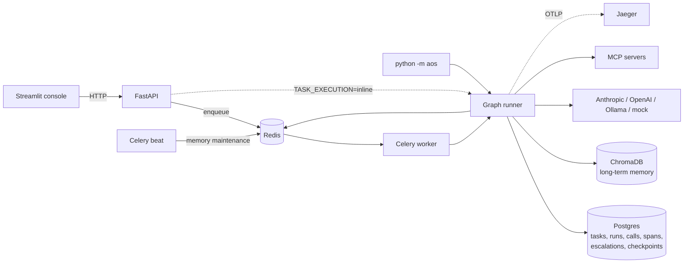
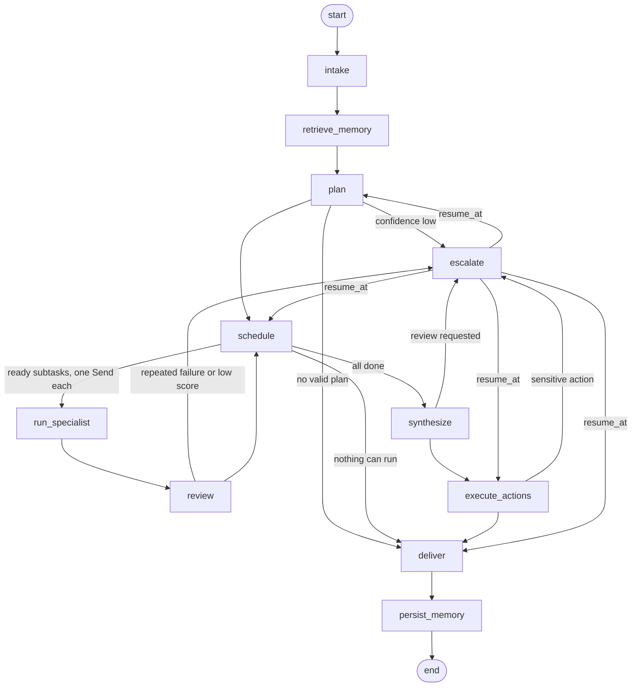

# Architecture

This covers how a request moves through the system and why each piece is shaped the way it is. The plan the system was built from is [IMPLEMENTATION_PLAN.md](IMPLEMENTATION_PLAN.md); where the two differ, this document describes the code.

## Processes



The API never runs a graph itself unless `TASK_EXECUTION=inline`. Submitting a task, resuming after a human decision and replaying a run are all Celery tasks, so any worker can pick up any run; the Postgres checkpointer holds everything a worker needs. `STORAGE_MODE=memory` replaces Postgres, Redis and the Chroma server with SQLite, fakeredis, an in-memory checkpointer and an in-process Chroma, which is what the tests use.

## The graph



One node per file in `src/aos/graph/nodes/`. Each is wrapped by `traced_node`, which opens a `node.<name>` span and summarises the node's events into the span's decision and status.

- **intake** records the run and creates its working-memory namespace.
- **retrieve_memory** searches long-term memory for the user and request and puts a `PlanningContext` in state.
- **plan** asks the supervisor for an `ExecutionPlan`, then validates it: unique ids, known specialists, no unknown or self dependencies, no cycles. `infer_dependencies` adds edges the model named in a description or input but forgot to declare, and makes a writing subtask with no dependencies wait for every non-writing one. An invalid plan is sent back to the supervisor once with the errors listed; if it is still invalid the run ends with the errors.
- **schedule** marks every subtask whose dependencies are done as `running`; `routing.dispatch` sends one `run_specialist` branch per ready subtask with `Send`, so independent subtasks run in parallel and the reducers on `results`, `subtask_status` and the counters merge their updates.
- **run_specialist** runs one specialist's tool loop for one subtask and returns a `SpecialistResult`.
- **review** reviews every result from that superstep in parallel. A rejection sends the subtask back with the reviewer's feedback, up to `MAX_REVISIONS` (2); a failed attempt is retried with a hint to try a different tool or approach. A subtask that fails `MAX_ATTEMPTS` (2) times, or still scores below `REVIEW_ESCALATE_SCORE` after its last revision, goes to the escalation policy; one scoring above it is accepted with a warning.
- **synthesize** merges the approved outputs into the deliverable and collects proposed actions.
- **execute_actions** runs approved actions and re-checks the action policy before each one.
- **escalate** turns pending escalation requests into queue rows and `interrupt()`s.
- **deliver** writes the final status and output.
- **persist_memory** extracts and stores memories from the finished run.

### State

`TaskState` is a `TypedDict` of plain JSON so checkpoints can be read by any process and compared across runs. Fields that parallel branches write (`results`, `reviews`, `visits`, `failures`, `revisions`, `feedback`, `subtask_status`) use a dict-merge reducer; `events` and `escalations` append. The plan is stored as a dict and re-validated with `load_plan` wherever it is used.

## Agents

| Agent | Job | Output |
|---|---|---|
| Supervisor | Decompose the request; cite memories it relied on | `ExecutionPlan` with subtasks, confidence and `memory_influence` |
| Research | Web search, HTTP fetch, MCP tools | `SpecialistOutput` |
| Data analysis | Read-only SQL, Python, HTTP fetch, MCP tools | `SpecialistOutput` |
| Writing | Drafts from upstream outputs; may propose `send_email` | `SpecialistOutput` |
| Code | Python execution, workspace files; may propose `file_delete` | `SpecialistOutput` |
| Reviewer | Score work against the expected output and the evidence | `ReviewVerdict` |

Every specialist can also read and write files in the run's workspace.

A specialist's loop alternates model calls and tool calls for at most `SPECIALIST_MAX_STEPS` steps. Every successful tool result is kept as evidence (the last six, 1,500 characters each) and travels with the result to the reviewer. A repeated identical call returns a reminder instead of running again.

Structured output works the same across providers: Anthropic and OpenAI get a forced `respond` tool whose schema is the Pydantic model; Ollama gets a tools phase and then a call with the JSON schema as its `format`, because small local models put answers inside tool arguments when both are offered at once.

### Guards that do not trust the model

- **Figure check.** `reviewer.unsupported_figures` extracts every number of two or more digits from the work and looks for it, allowing rounding and percentage forms, in the request, the subtask inputs, upstream outputs and the evidence. Any miss caps the score at 0.45 and rejects the work, whatever the model's verdict.
- **Sensitive tools.** A sensitive tool is offered only when the plan lists it in the subtask's `actions` and the request itself asks for it (`tools/policy.py`). Calling it queues a `ProposedAction` instead of running it, and the tool is then withdrawn for the rest of the attempt.
- **Recipients.** `send_email` may only go to addresses in the request or the configured directory, so a model cannot invent a recipient.
- **Registry.** Every tool call passes `ToolRegistry.invoke`: the agent must be allowed the tool, arguments must validate, a Redis fixed-window rate limit applies, the call has a timeout, and the call is logged to `tool_calls`.

## Models

`config/models.yaml` gives each role (supervisor, each specialist, reviewer, memory) a chain of `provider:model` entries per complexity. The router skips providers without credentials and falls back down the chain on errors after retries. Every call is recorded in `llm_calls` with its request, response, tokens, cost, latency, span id and a `call_key` used by replay. `LLM_MODE=mock` replaces every provider with scripted responses from `tests/fixtures/mock_llm/*.yaml`, picked by markers and keywords in the request.

## Memory

| | Working memory | Long-term memory |
|---|---|---|
| Store | Redis hash per run | ChromaDB collection, one per deployment |
| Lifetime | the run, 24 h TTL as a backstop | until it decays or the user is forgotten |
| Holds | intermediate outputs shared by specialists | episodes, approaches, tool usage, facts, preferences, human decisions |

**Writing.** When a run ends, `persist_memory` stores a `task_episode` built from the run record without a model call, then asks the memory model for up to eight lessons (`approach`, `tool_usage`, `fact`, `preference`). Each new memory is compared with the user's existing ones; above `MEMORY_DEDUPE_SIMILARITY` (0.92) the existing memory gains a little importance instead of a copy being added. Human decisions are stored as `human_decision` memories when they are made.

**Reading.** `retrieve_memory` takes the top `MEMORY_TOP_K` above the embedder's minimum similarity, ranked by `similarity × (0.7 + 0.3 × effective importance)`. The planner sees them with short ids and must cite the ones it used in `memory_influence`; cited memories get an access recorded, and every retrieval is logged to `memory_retrievals` with whether it was used.

**Scoring.** Importance is the stored base plus `0.1 × ln(1 + accesses)`, capped at 1. It decays with a half-life of `MEMORY_HALF_LIFE_DAYS` (30) since last access; preferences decay six times slower and human decisions three times slower.

**Maintenance** (Celery beat, hourly): memories whose effective importance falls below `MEMORY_EXPIRE_BELOW` are deleted, and clusters above the consolidation similarity are merged into one summary memory, tagged `consolidated`, with the cluster's highest importance plus 0.1. `DELETE /users/{id}/memories` removes everything for a user.

**Embeddings.** The default `hash` embedder needs no model and matches shared vocabulary, so its thresholds are lower (minimum 0.15, consolidation 0.55). `ollama` and `openai` embedders use 0.35 and 0.85. Both can be overridden.

## Human in the loop

| Trigger | Default level | Resumes at |
|---|---|---|
| Plan confidence below `PLAN_CONFIDENCE_THRESHOLD` (0.6) | APPROVE_PLAN | schedule, or plan again with feedback |
| Plan confidence below `PLAN_NOTIFY_THRESHOLD` (0.75) | NOTIFY | schedule, without pausing |
| A subtask failed `MAX_ATTEMPTS` times | TAKE_OVER | schedule |
| Score below `REVIEW_ESCALATE_SCORE` after the last revision | APPROVE_ACTION | schedule |
| A sensitive action was proposed | APPROVE_ACTION | execute_actions |
| The task was submitted with review requested | APPROVE_ACTION | execute_actions |

Levels and switches live in `config/escalation.yaml`; thresholds are settings.

`escalate` writes an `escalations` row with the packaged context (plan, the subtask's attempts and reviews, the proposed action, past decisions on similar steps), sends notifications, then calls `interrupt()`. The run's checkpoint is the durable pause: the process can exit, and `POST /escalations/{id}/decision` enqueues a resume with `Command(resume=decision)` on whichever worker is free.

LangGraph re-executes the interrupted node from the top on resume, so everything before `interrupt()` is idempotent. Queue rows are keyed by `step_key#n`, where `n` counts earlier escalations of the same step, and an existing open row is reused rather than duplicated.

Decisions are `approve`, `modify` (edited plan, output or action arguments), `reject` (with a reason that becomes feedback) and `take_over` (the human's output replaces the subtask's). While a run waits, `POST /escalations/{id}/chat` lets the reviewer ask the supervisor about the step with the same context the queue shows.

## Tracing

Each graph invocation (the first run, every resume, every replay) is one OpenTelemetry trace rooted at `task.run` or `task.resume`. Below it:

```
task.run
  node.retrieve_memory
    memory.retrieve
  node.plan
    llm.call                 agent, model, tokens, cost, latency, call_key
  node.run_specialist        one per parallel branch
    llm.call
    tool.invoke              tool, agent, success, latency, replayed
  node.review
    llm.call
  node.escalate
    hitl.escalation          trigger, level, decision, review_seconds
  node.persist_memory
    memory.persist
```

Attributes use an `aos.` prefix. Spans go to Postgres through a `BatchSpanProcessor`, flushed when each invocation ends, and to any OTLP collector named by `OTEL_EXPORTER_OTLP_ENDPOINT`. `llm_calls` and `tool_calls` rows carry their span id, so the trace explorer shows the prompt and response for a model span and the arguments and output for a tool span.

Costs come from `config/pricing.yaml`: per-model prices for hosted models, zero for Ollama, and simulated prices for the mock provider so cost views have something to show. Run totals are stored in `runs.metrics`; `GET /metrics/summary` aggregates cost by task type, model, tool latency percentiles, failure rates, escalation rate and review time.

## Replay

Replay re-runs a finished run as a new run of a new task with `parent_run_id` set, using the parent's recorded model answers instead of calling models.

- **Matching.** A call is identified by `call_key`, a hash of role, purpose, subtask, attempt and message count, plus its position among calls with the same key. The recorded answer is reused only if the prompt hash also matches; the first call that does not match is the divergence point, and from there calls go to real (or mock) models.
- **Overrides.** `POST /runs/{id}/replay` accepts replacement responses keyed by `llm_calls.id`. The overridden step returns the edited answer and everything downstream runs again, so the comparison shows what that one change caused.
- **Tools.** Recorded tool outputs, failures included, are returned for the same subtask, agent, tool and arguments. Sensitive tools are never executed in a replay.
- **Humans and memory.** Recorded decisions answer the replay's escalations without opening queue rows. Retrieval reuses the parent's memory context, and replays write no memories.
- **Comparison.** `GET /runs/{a}/compare/{b}` diffs the plans, each subtask's outputs and review scores, the escalations, the final output and the metrics.

This is replay from recorded calls rather than forking a LangGraph checkpoint. Forking would replay the graph's state exactly but cannot show the effect of a changed answer early in the run, and checkpoints written before a code change may not load after it. Recorded calls survive both, at the cost of needing deterministic prompts: anything rendered into a prompt from stored JSON is sorted, because Postgres JSONB does not keep key order.

## Data model

| Table | Holds |
|---|---|
| `tasks` | request, user, status, final output |
| `runs` | one per execution of a task: plan, status, metrics, trace id, `parent_run_id` for replays |
| `llm_calls` | every model call: request, response, tokens, cost, latency, span id, call key, replayed flag |
| `tool_calls` | every tool call: agent, args, output, success, latency, span id |
| `outbox` | emails sent by `send_email` (written to this table, not to a mail server) |
| `escalations` | queue rows: trigger, level, context, decision, chat, timings |
| `notifications` | in-app and webhook notifications for escalations |
| `memory_retrievals` | which memories each run retrieved and used |
| `spans` | the trace tree |

Each day of the build added tables but never columns, since there is no migration tool; `init_db` creates whatever is missing.
