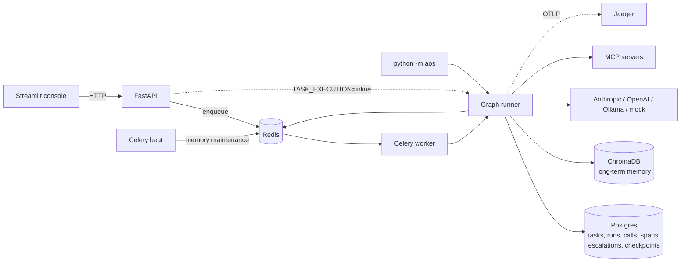
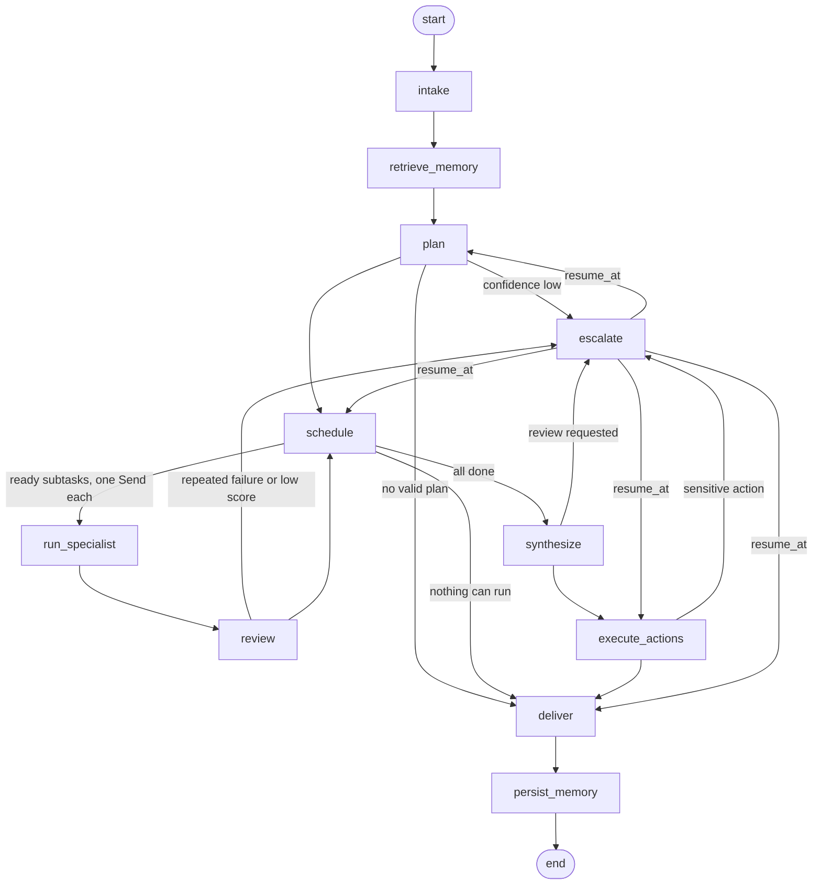

# Architecture

How a request moves through AOS, and the reasons behind the main design choices.

## Processes



The API doesn't run graphs itself unless `TASK_EXECUTION=inline`. New tasks, resumes after a human decision and replays are all Celery tasks, and the Postgres checkpointer holds everything a worker needs, so any worker can pick up any run. The tests use `STORAGE_MODE=memory`, which swaps Postgres, Redis and the Chroma server for SQLite, fakeredis, an in-memory checkpointer and an in-process Chroma.

## The graph



Each node lives in its own file under `src/aos/graph/nodes/` and is wrapped by `traced_node`, which opens a `node.<name>` span and records the node's decision and status on it.

- `intake` records the run and creates its working-memory namespace.
- `retrieve_memory` searches long-term memory for the user and request and puts a `PlanningContext` in state.
- `plan` asks the supervisor for an `ExecutionPlan`, then validates it: unique ids, known specialists, no unknown or self dependencies, no cycles. `infer_dependencies` adds edges the model named in a description or input but forgot to declare, and makes a writing subtask with no dependencies wait for every non-writing one. An invalid plan is sent back to the supervisor once with the errors listed; if it is still invalid the run ends with the errors.
- `schedule` marks every subtask whose dependencies are done as `running`; `routing.dispatch` sends one `run_specialist` branch per ready subtask with `Send`, so independent subtasks run in parallel and the reducers on `results`, `subtask_status` and the counters merge their updates.
- `run_specialist` runs one specialist's tool loop for one subtask and returns a `SpecialistResult`.
- `review` checks every result from that superstep in parallel. A rejection sends the subtask back with the reviewer's feedback, up to `MAX_REVISIONS` (2); a failed attempt is retried with a hint to try a different tool or approach. A subtask that fails `MAX_ATTEMPTS` (2) times, or still scores below `REVIEW_ESCALATE_SCORE` after its last revision, goes to the escalation policy; one scoring above it is accepted with a warning.
- `synthesize` merges the approved outputs into the deliverable and collects proposed actions.
- `execute_actions` runs approved actions and re-checks the action policy before each one.
- `escalate` turns pending escalation requests into queue rows and `interrupt()`s.
- `deliver` writes the final status and output.
- `persist_memory` extracts and stores memories from the finished run.

### State

`TaskState` is a `TypedDict` of plain JSON so checkpoints can be read by any process and compared across runs. Fields that parallel branches write (`results`, `reviews`, `visits`, `failures`, `revisions`, `feedback`, `subtask_status`) use a dict-merge reducer; `events` and `escalations` append. The plan is stored as a dict and re-validated with `load_plan` wherever it is used.

## Agents

| Agent | Job | Output |
|---|---|---|
| Supervisor | Decompose the request; cite memories it relied on | `ExecutionPlan` with subtasks, confidence and `memory_influence` |
| Research | Web search, HTTP fetch, MCP tools | `SpecialistOutput` |
| Data analysis | Read-only SQL, Python, HTTP fetch, MCP tools | `SpecialistOutput` |
| Writing | Drafts from upstream outputs; may propose `send_email` | `SpecialistOutput` |
| Code | Python execution, workspace files; may propose `file_delete` | `SpecialistOutput` |
| Reviewer | Score work against the expected output and the evidence | `ReviewVerdict` |

Every specialist can also read and write files in the run's workspace.

A specialist's loop alternates model calls and tool calls for at most `SPECIALIST_MAX_STEPS` steps. Every successful tool result is kept as evidence (the last six, 1,500 characters each) and travels with the result to the reviewer. A repeated identical call returns a reminder instead of running again.

Anthropic and OpenAI return structured output through a forced `respond` tool whose schema is the Pydantic model. Ollama gets a tools phase first and then a separate call with the JSON schema as its `format`, because small local models tend to put their answer inside tool arguments when both are offered at once.

### Checks enforced in code

`reviewer.unsupported_figures` pulls every number with two or more digits out of the work and looks for it in the request, the subtask inputs, upstream outputs and the evidence, allowing for rounding and percentages. If any number is missing, the score is capped at 0.45 and the work is rejected, even if the model approved it.

A sensitive tool is only offered when the plan lists it in the subtask's `actions` and the request itself asks for it (`tools/policy.py`). Calling it queues a `ProposedAction` rather than running it, and the tool is withdrawn for the rest of that attempt. `send_email` can only go to addresses written in the request or listed in the configured directory, so a model can't make up a recipient.

Every tool call goes through `ToolRegistry.invoke`, which checks that the agent is allowed the tool, validates the arguments, applies a Redis fixed-window rate limit, enforces a timeout and logs the call to `tool_calls`.

## Models

`config/models.yaml` gives each role (supervisor, each specialist, reviewer, memory) a chain of `provider:model` entries per complexity. The router skips providers without credentials and falls back down the chain on errors after retries. Every call is recorded in `llm_calls` with its request, response, tokens, cost, latency, span id and a `call_key` used by replay. `LLM_MODE=mock` replaces every provider with scripted responses from `tests/fixtures/mock_llm/*.yaml`, picked by markers and keywords in the request.

## Memory

| | Working memory | Long-term memory |
|---|---|---|
| Store | Redis hash per run | ChromaDB collection, one per deployment |
| Lifetime | the run, 24 h TTL as a backstop | until it decays or the user is forgotten |
| Holds | intermediate outputs shared by specialists | episodes, approaches, tool usage, facts, preferences, human decisions |

When a run ends, `persist_memory` stores a `task_episode` built from the run record without a model call, then asks the memory model for up to eight lessons (`approach`, `tool_usage`, `fact`, `preference`). Each new memory is compared with the user's existing ones; above `MEMORY_DEDUPE_SIMILARITY` (0.92) the existing memory gains a little importance instead of a copy being added. Human decisions are stored as `human_decision` memories when they are made.

`retrieve_memory` takes the top `MEMORY_TOP_K` above the embedder's minimum similarity, ranked by `similarity × (0.7 + 0.3 × effective importance)`. The planner sees them with short ids and must cite the ones it used in `memory_influence`; cited memories get an access recorded, and every retrieval is logged to `memory_retrievals` with whether it was used.

Importance is the stored base plus `0.1 × ln(1 + accesses)`, capped at 1. It decays with a half-life of `MEMORY_HALF_LIFE_DAYS` (30) since last access; preferences decay six times slower and human decisions three times slower.

An hourly Celery beat job deletes memories whose effective importance falls below `MEMORY_EXPIRE_BELOW` and merges clusters above the consolidation similarity into one summary memory, tagged `consolidated`, with the cluster's highest importance plus 0.1. `DELETE /users/{id}/memories` removes everything for a user.

The default `hash` embedder needs no model and matches shared vocabulary, so its thresholds are lower (minimum 0.15, consolidation 0.55). `ollama` and `openai` embedders use 0.35 and 0.85. Both can be overridden.

## Human in the loop

| Trigger | Default level | Resumes at |
|---|---|---|
| Plan confidence below `PLAN_CONFIDENCE_THRESHOLD` (0.6) | APPROVE_PLAN | schedule, or plan again with feedback |
| Plan confidence below `PLAN_NOTIFY_THRESHOLD` (0.75) | NOTIFY | schedule, without pausing |
| A subtask failed `MAX_ATTEMPTS` times | TAKE_OVER | schedule |
| Score below `REVIEW_ESCALATE_SCORE` after the last revision | APPROVE_ACTION | schedule |
| A sensitive action was proposed | APPROVE_ACTION | execute_actions |
| The task was submitted with review requested | APPROVE_ACTION | execute_actions |

Levels and switches live in `config/escalation.yaml`; thresholds are settings.

`escalate` writes an `escalations` row with the packaged context (plan, the subtask's attempts and reviews, the proposed action, past decisions on similar steps), sends notifications, then calls `interrupt()`. The checkpoint is what makes the pause durable. The process can exit, and `POST /escalations/{id}/decision` later enqueues a resume with `Command(resume=decision)` on whichever worker is free.

LangGraph re-executes the interrupted node from the top on resume, so everything before `interrupt()` is idempotent. Queue rows are keyed by `step_key#n`, where `n` counts earlier escalations of the same step, and an existing open row is reused rather than duplicated.

Decisions are `approve`, `modify` (edited plan, output or action arguments), `reject` (with a reason that becomes feedback) and `take_over` (the human's output replaces the subtask's). While a run waits, `POST /escalations/{id}/chat` lets the reviewer ask the supervisor about the step with the same context the queue shows.

## Tracing

Each graph invocation (the first run, every resume, every replay) is one OpenTelemetry trace rooted at `task.run` or `task.resume`. Below it:

```
task.run
  node.retrieve_memory
    memory.retrieve
  node.plan
    llm.call                 agent, model, tokens, cost, latency, call_key
  node.run_specialist        one per parallel branch
    llm.call
    tool.invoke              tool, agent, success, latency, replayed
  node.review
    llm.call
  node.escalate
    hitl.escalation          trigger, level, decision, review_seconds
  node.persist_memory
    memory.persist
```

Attributes use an `aos.` prefix. Spans go to Postgres through a `BatchSpanProcessor`, flushed when each invocation ends, and to any OTLP collector named by `OTEL_EXPORTER_OTLP_ENDPOINT`. `llm_calls` and `tool_calls` rows carry their span id, so the trace explorer shows the prompt and response for a model span and the arguments and output for a tool span.

Costs come from `config/pricing.yaml`: per-model prices for hosted models, zero for Ollama, and simulated prices for the mock provider so cost views have something to show. Run totals are stored in `runs.metrics`; `GET /metrics/summary` aggregates cost by task type, model, tool latency percentiles, failure rates, escalation rate and review time.

## Replay

A replay runs a finished task again as a new task and run, with `parent_run_id` pointing at the original, and answers model calls from the original's recordings.

Each call is identified by its `call_key` (a hash of role, purpose, subtask, attempt and message count) and its position among calls with the same key. A recorded answer is reused only if the prompt hash matches too. The first call that doesn't match is the divergence point, and from there on calls go to the real (or mock) models.

`POST /runs/{id}/replay` takes replacement responses keyed by `llm_calls.id`. The edited step returns the new answer and everything after it runs again, so the comparison shows what that one change caused.

Tool outputs, including failures, are replayed for the same subtask, agent, tool and arguments, and sensitive tools never run. Recorded human decisions answer the replay's escalations without opening queue rows. Retrieval reuses the original run's memory context, and replays don't write memories. `GET /runs/{a}/compare/{b}` diffs the plans, each subtask's outputs and review scores, the escalations, the final output and the metrics.

Forking a LangGraph checkpoint would reproduce the graph state exactly, but it can't show what a changed answer early in the run would do, and checkpoints from older code may not load after a change. Recorded calls handle both cases. The cost is that prompts have to render the same way every time, so anything built from stored JSON is sorted first (Postgres JSONB doesn't keep key order).

## Data model

| Table | Holds |
|---|---|
| `tasks` | request, user, status, final output |
| `runs` | one per execution of a task: plan, status, metrics, trace id, `parent_run_id` for replays |
| `llm_calls` | every model call: request, response, tokens, cost, latency, span id, call key, replayed flag |
| `tool_calls` | every tool call: agent, args, output, success, latency, span id |
| `outbox` | emails sent by `send_email` (written to this table, not to a mail server) |
| `escalations` | queue rows: trigger, level, context, decision, chat, timings |
| `notifications` | in-app and webhook notifications for escalations |
| `memory_retrievals` | which memories each run retrieved and used |
| `spans` | the trace tree |

There's no migration tool, so schema changes only add tables, never columns. `init_db` creates whatever is missing.
