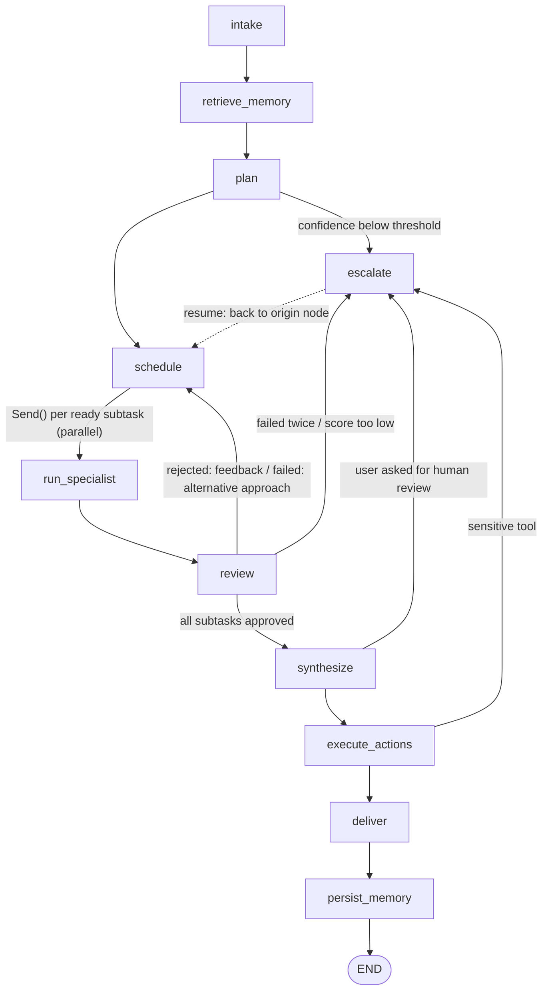

# Agent Orchestration System (AOS) — 3-Day Implementation Plan

**What we're building:** a multi-agent orchestration platform. A **Supervisor** breaks a complex request into a dependency graph of subtasks. **Specialist** agents (research, data analysis, writing, code) carry them out with real tools. A **Reviewer** checks every output. **Memory** carries lessons from one task to the next. A **human** approves risky or low-confidence steps. **Every decision is traced, costed and replayable.**

**How the 3 days connect:** each day ends with a working system. It also leaves named *seams* (§1) that the next day fills in, so later days add to the code and never rewrite it.

| Day | Theme | What you can demo at the end of the day |
|---|---|---|
| 1 | Core engine: agents, tools, LangGraph | A request goes in → plan → parallel specialists using tools → reviewer loop → answer comes out (CLI + API + worker) |
| 2 | Memory + human-in-the-loop | Runs remember past tasks, plan better when a task repeats, and pause for human approval, then resume from a Streamlit review console |
| 3 | Observability, replay, packaging | Trace explorer, cost dashboard, replay with diffs, a one-command docker-compose demo, e2e tests, README |

**Agent workflow** (details in [AGENTS.md](../AGENTS.md)):
- `build day N` → the build agent implements Day N and keeps `docs/progress/DAY-N.md` up to date.
- `commit day N work` → the commit agent commits Day N exactly as `DAY-N.md` describes (one commit per phase), tags `day-N`, and pushes.

---

## 0. Fixed decisions (apply to all days)

| Area | Decision | Reason |
|---|---|---|
| Language / env | Python 3.11+, package `aos` under `src/`, managed with `uv` | Fast installs and a reproducible lockfile |
| Orchestration | LangGraph `StateGraph` with a Postgres checkpointer | Durable state is what makes pause/resume (Day 2) and replay (Day 3) possible |
| LLM access | A thin provider layer of our own over the `anthropic` and `openai` SDKs (no LangChain model wrappers) | Full control over structured output, token accounting and call recording |
| Model routing | `config/models.yaml`: supervisor → `claude-opus-5-5`; specialists → `claude-sonnet-5-5` (medium/high complexity) or `claude-haiku-5-5` (low); reviewer → the OpenAI model set in `OPENAI_REVIEWER_MODEL`. Each role falls back to the other provider. | A reviewer from a different provider avoids a model grading its own work. Every choice can be overridden |
| Offline mode | `LLM_MODE=mock` (default): deterministic scripted responses from `tests/fixtures/mock_llm/` | Tests, CI and the demo run with no API keys and give the same output every time |
| Storage | Postgres = system of record (tasks, runs, tool/LLM calls, escalations, spans) + LangGraph checkpoints. Redis = Celery broker, working memory, rate-limit buckets. ChromaDB = long-term memory | Follows the spec's split between short-term and long-term memory |
| Test storage | `STORAGE_MODE=memory` → SQLite, fakeredis, Chroma `EphemeralClient`, LangGraph `InMemorySaver` | Unit tests need no Docker |
| Execution | FastAPI enqueues work; a Celery worker runs the graph; parallel subtasks use LangGraph `Send` inside the run | The API never blocks on LLM calls, and parallel work shows up in the graph and in traces |
| UI | A Streamlit multi-page app that talks **only** to the API | Fits in 3 days. It can later be replaced with React without backend changes |
| Sensitive actions | Specialists *propose* sensitive tool calls. A separate `execute_actions` node runs them | Lets Day 2 put an approval gate in front of them without re-running specialists |
| Schema changes | Day 1 defines every column its tables need. Later days add **new tables only** | There is no migration tool in a 3-day scope (`python -m aos db reset` for dev) |
| Windows dev | Run Celery with `--pool=solo` locally, or run the worker in Docker | Celery's default pool doesn't support Windows |

Everyday commands (keep the README in sync):
```bash
docker compose up -d postgres redis chromadb
uv sync
uv run python -m aos db init
uv run uvicorn aos.api.main:app --reload
uv run celery -A aos.worker.celery_app worker --pool=solo -l info
uv run python -m aos run "Research the top 3 open-source vector databases and write an executive summary" --sync
uv run streamlit run ui/Home.py
uv run pytest -q
```

---

## 1. Seams: how each day plugs into the one before

| Seam (created on Day 1) | Day 1 behaviour | Filled in |
|---|---|---|
| `graph/nodes/memory.py` → `retrieve_memory`, `persist_memory` | pass-through | 2.2, 2.3 |
| `graph/nodes/escalate.py` + predicates in `graph/routing.py` | logs "would escalate (level)", then auto-approves | 2.5, 2.6 |
| `graph/nodes/actions.py` → `execute_actions` | runs proposed actions directly | 2.6 (approval gate) |
| `ToolSpec.sensitive` flag | stored, not acted on | 2.5 |
| `ExecutionPlan.memory_influence` field | always empty | 2.3 |
| `TaskState.working_memory_ref` | unused | 2.1 |
| `aos.context` contextvars (run_id, subtask_id, agent, attempt) | used in log lines | 3.1 span attributes, 3.4 replay call keys |
| `llm/hooks.py` → `on_llm_call(record)` | saves an `llm_calls` row (prompt, response, tokens, latency) | 3.1 spans, 3.2 cost, 3.4 replay |
| `graph/instrument.py` → `@traced_node` on every node | structured log line with duration and status | 3.1 OpenTelemetry spans |
| `tools/registry.invoke()`, the single choke point for tool calls | checks permissions and rate limits, validates input, saves a `tool_calls` row | 2.5 sensitive gate, 3.1 spans |
| Postgres checkpointer, `runs.thread_id` | durability | 2.6 interrupt/resume, 3.4 time-travel replay |
| `runs.parent_run_id`, `runs.trace_id`, `runs.traceparent`, `llm_calls.call_key` | null | 3.1, 3.4 |

Final graph. Day 1 builds every node; Day 2 makes `escalate` real.



`after_escalation` sends the run back to whichever node raised the escalation (`plan`, `schedule`, `synthesize` or `execute_actions`). The dotted edge stands for all of them.

---

## 2. Repository layout (final state; `[n]` = the day the file first appears)

```
AOS/
├── AGENTS.md, CLAUDE.md                     [0]  agent context + build/commit protocols
├── README.md                                [3]
├── pyproject.toml, uv.lock                  [1]
├── .gitignore, .env.example                 [1]
├── .dockerignore                            [3]
├── docker-compose.yml                       [1]  infra only → [3] full stack
├── docker/app.Dockerfile, ui.Dockerfile     [3]
├── .github/workflows/ci.yml                 [3]
├── config/
│   ├── models.yaml                          [1]
│   ├── tools.yaml, mcp_servers.yaml         [1]
│   ├── escalation.yaml                      [2]
│   └── pricing.yaml                         [3]
├── src/aos/
│   ├── __main__.py                          [1]  CLI: db, run, llm-smoke (+ memory maintain [2])
│   ├── config.py, logging.py, context.py    [1]
│   ├── db/models.py, session.py             [1]  (+ new tables [2], [3])
│   ├── schemas/plan.py, results.py, review.py, state.py   [1]
│   ├── schemas/memory.py, escalation.py     [2]
│   ├── llm/base.py, anthropic_provider.py, openai_provider.py, mock_provider.py, router.py, hooks.py  [1]
│   ├── tools/base.py, registry.py, ratelimit.py, mcp_adapter.py, builtin/*  [1]
│   ├── agents/supervisor.py, reviewer.py, specialists/*, prompts/*.md        [1]
│   ├── graph/builder.py, routing.py, checkpointer.py, instrument.py, nodes/* [1]
│   ├── memory/working.py, embeddings.py, longterm.py, extraction.py, retrieval.py, management.py  [2]
│   ├── hitl/levels.py, policy.py, queue.py, notifications.py, chat.py        [2]
│   ├── observability/tracing.py, exporter.py, costs.py, metrics.py          [3]
│   ├── replay/recorder.py, engine.py, compare.py                            [3]
│   ├── api/main.py, routes/tasks.py         [1]; routes/memory.py, escalations.py [2]; routes/traces.py, metrics.py, replay.py [3]
│   └── worker/celery_app.py, tasks.py       [1]
├── mcp_servers/demo_server.py               [1]
├── ui/Home.py, lib/api_client.py, pages/1_Review_Queue.py, pages/2_Memory.py   [2]
├── ui/pages/3_Trace_Explorer.py, 4_Costs.py, 5_Replay.py                     [3]
├── scripts/seed.py, demo.py                 [3]
├── tests/conftest.py, fixtures/, unit/      [1–2];  tests/e2e/ [3]
└── docs/IMPLEMENTATION_PLAN.md, progress/DAY-*.md [0];  ARCHITECTURE.md, DEMO_SCRIPT.md, img/ [3]
```

One graph node per file under `graph/nodes/`, so each day's edits touch few shared files. This keeps per-phase commits clean.

---

## 3. Data model (Postgres)

| Table | Columns | Day |
|---|---|---|
| `tasks` | id, user_id, request, require_human_review, status, final_output, created_at, completed_at | 1 |
| `runs` | id, task_id, thread_id, parent_run_id, replay_of_checkpoint, status (`running`/`awaiting_human`/`completed`/`failed`), task_type, plan JSONB, wm_snapshot JSONB, metrics JSONB, trace_id, traceparent, started_at, ended_at | 1 (all columns) |
| `tool_calls` | id, run_id, subtask_id, agent, tool, input JSONB, output JSONB, success, error, latency_ms, span_id, created_at | 1 |
| `llm_calls` | id, run_id, subtask_id, agent, provider, model, call_key, prompt_hash, messages JSONB, response JSONB, input_tokens, output_tokens, cost_usd, latency_ms, replayed, span_id, created_at | 1 |
| `outbox` | id, run_id, channel, recipient, subject, body, created_at (`send_email` writes here and never actually sends) | 1 |
| `escalations` | id, run_id, task_id, step_key (unique with run_id), level, trigger, reason, status (`pending`/`auto_proceeded`/`approved`/`modified`/`rejected`/`taken_over`), context JSONB, proposed_action JSONB, decision JSONB, chat JSONB, decided_by, created_at, decided_at, review_seconds | 2 |
| `notifications` | id, escalation_id, channel, message, created_at, read_at | 2 |
| `memory_retrievals` | id, run_id, memory_id, kind, query, score, used_in_plan, created_at | 2 |
| `spans` | trace_id, span_id, parent_span_id, run_id, name, status, start_time, end_time, duration_ms, attributes JSONB, events JSONB | 3 |
| `demo.*` schema | benchmark dataset that `db_query` reads (test fixture on Day 1, seeded for the demo on Day 3) | 1 / 3 |

---

# Day 1 — Core engine

**Entry context:** an empty repo plus these docs.
**Goal:** a request goes in → validated plan → parallel tool-using specialists → reviewer loop → synthesized answer comes out, through the CLI and through API + worker, fully offline in mock mode.

### Phase 1.1 — Foundation (~1h)
**Builds on:** nothing (greenfield).
**Build:**
- `pyproject.toml` with **every Day 1 dependency** (langgraph, langgraph-checkpoint-postgres, anthropic, openai, pydantic, pydantic-settings, sqlalchemy 2, psycopg[binary], fastapi, uvicorn, celery[redis], redis, httpx, pyyaml, mcp, a web-search client; dev: pytest, pytest-asyncio, fakeredis, ruff) + `uv.lock`.
- extend the existing `.gitignore` (keep `AGENTS.md`, `CLAUDE.md` and the `.env` rules; add `.venv/`, `__pycache__/`, `.pytest_cache/`, `.ruff_cache/`, `workspace/`, `data/`, `*.sqlite`, `chroma/`) and `.env.example` (every variable, empty values, no key-shaped placeholders).
- `src/aos/config.py`: a pydantic-settings `Settings` with LLM_MODE, STORAGE_MODE, DATABASE_URL, REDIS_URL, CHROMA_HOST/PORT, ANTHROPIC_API_KEY, OPENAI_API_KEY, OPENAI_REVIEWER_MODEL, TAVILY_API_KEY, WORKSPACE_DIR, and the escalation thresholds.
- `src/aos/logging.py`: JSON log lines that include the context vars.
- `src/aos/db/models.py`, `session.py`: all Day 1 tables with **every** column from §3, plus `init_db()` and `reset_db()`.
- `src/aos/__main__.py`: `db init`, `db reset`.
- `docker-compose.yml`: postgres:16, redis:7, chromadb/chroma, with healthchecks and named volumes (app services come on Day 3).

**Hands to 1.2:** `settings`, `get_session()`, tables.
**Done when:** `docker compose up -d postgres redis chromadb` comes up healthy; `uv run python -m aos db init` creates the tables; `uv run ruff check .` is clean.

### Phase 1.2 — LLM layer + core schemas (~1.5h)
**Builds on:** settings, the `llm_calls` table.
**Build:**
- `context.py`: contextvars for run_id, task_id, subtask_id, agent, attempt, plus a `bind(...)` context manager.
- `llm/base.py`: `LLMProvider.complete(messages, system=None, schema=None, tools=None, max_tokens=...) -> LLMResult(text, parsed, tool_calls, usage{input, output}, model, provider, latency_ms)`. Structured output works like this: on Anthropic, a forced tool call whose input schema is the Pydantic JSON schema; on OpenAI, a `json_schema` response format. The response is parsed with Pydantic; on a validation error there is one repair round-trip that sends back the error text.
- `llm/anthropic_provider.py`, `openai_provider.py`, `mock_provider.py`. The mock reads YAML scripts keyed by `role` + `scenario` (the scenario is picked from keywords in the request; default `generic`). It supports sequences (the first call returns X, the second returns Y) so tests can script reviewer rejections and failures.
- `llm/router.py`: `get_llm(role, complexity="medium")` reads `config/models.yaml` and returns a provider wrapper. Transient errors get 2 retries with backoff, then the call falls back to the other provider.
- `llm/hooks.py`: `register_llm_hook()` and `emit(record)`. The default hook writes an `llm_calls` row.
- `schemas/plan.py`:
  - `Subtask`: id, description, specialist ∈ {research, data_analysis, writing, code}, depends_on, inputs, expected_output, complexity ∈ {low, medium, high}, approach_hint.
  - `ExecutionPlan`: task_type, rationale, confidence (0–1), subtasks, memory_influence[] (seam).
  - `validate_plan()` rejects unknown specialists, missing dependencies, cycles, empty plans and plans with more than 12 subtasks.
  - `ready_subtasks(plan, status)`.
- `schemas/results.py`: `ProposedAction(tool, args, reasoning)` and `SpecialistResult(subtask_id, status, output, data, proposed_actions, confidence, attempt, error)`.
- `schemas/review.py`: `Review(subtask_id, approved, score, issues, feedback)`.
- `schemas/state.py`: `TaskState` TypedDict with reducers on results, reviews and attempts (needed because parallel `Send` branches write at the same time), plus `escalation` and `working_memory_ref` slots.
- `config/models.yaml`, and `tests/fixtures/mock_llm/` scripts for the `generic` and `vector_db_report` scenarios.

**Hands to 1.3/1.4:** `get_llm`, all schemas, `bind()`.
**Done when:** unit tests show the mock returns a parsed `ExecutionPlan`; `validate_plan` catches a cycle, an unknown specialist and a missing dependency; the router falls back when the primary provider raises an error; an `llm_calls` row is written.

### Phase 1.3 — Tool registry, built-in tools, MCP (~2h)
**Builds on:** context vars (who is calling), the `tool_calls` table.
**Build:**
- `tools/base.py`: `ToolSpec(name, description, input_model, output_model, allowed_agents, rate_limit_per_min, timeout_s, sensitive, handler)` and `ToolResult(success, output, error, latency_ms)`.
- `tools/registry.py`: `register()`, `list_for(agent)` (returns tool schemas ready for the provider), and `invoke(agent, name, args)`. `invoke` runs these steps in order: permission check → input validation → rate limit (`tools/ratelimit.py`: a Redis token bucket, in-memory under `STORAGE_MODE=memory`) → the handler, with a timeout → output validation → a `tool_calls` row. It **never raises** on a tool failure: it returns `ToolResult(success=False)` so agents can recover.
- `tools/builtin/`:

  | Tool | Allowed agents | Notes |
  |---|---|---|
  | `web_search` | research | mock: fixtures in `tests/fixtures/web/`; live: Tavily if `TAVILY_API_KEY` is set, else DuckDuckGo |
  | `http_get` | research, data_analysis | GET only, domain allowlist from `config/tools.yaml` |
  | `file_read`, `file_write` | all specialists | confined to `WORKSPACE_DIR/<run_id>/`, with a path-traversal guard |
  | `code_exec` | data_analysis, code | Python in a subprocess, in a temp dir, 10 s timeout, output cap, secrets stripped from the environment. **Not a real sandbox.** This is documented; production would use gVisor or Firecracker |
  | `db_query` | data_analysis | SELECT only, read-only transaction, `demo` schema, row cap |
  | `send_email` | writing | **sensitive**; writes to `outbox` and never sends |
  | `file_delete` | code | **sensitive** |

- `tools/mcp_adapter.py`: reads `config/mcp_servers.yaml`, starts each server over stdio with the `mcp` SDK, calls `list_tools()`, and registers each tool as `mcp.<server>.<tool>` (JSON schema passed through, with a sync wrapper around the async session). `mcp_servers/demo_server.py` (FastMCP) exposes `unit_convert` and `company_lookup`, both backed by fixture data.
- `config/tools.yaml`: allowed agents, rate limits, HTTP allowlist.

**Hands to 1.4:** `registry.list_for()` and `registry.invoke()`; `ToolSpec.sensitive`.
**Done when:** tests show a disallowed agent is denied; the rate limit trips; a `../` path escape is blocked; a `code_exec` timeout returns a failure result; every call writes a `tool_calls` row; the MCP demo tool is listed and callable.

### Phase 1.4 — Agents (~1.5h)
**Builds on:** `get_llm`, schemas, registry.
**Build:**
- `agents/prompts/*.md`: `supervisor_plan`, `supervisor_synthesize`, `specialist_<role>`, `reviewer`.
- `agents/supervisor.py`:
  - `plan(request, memory_context=None, feedback=None) -> ExecutionPlan` uses structured output. If validation fails, it re-plans once and passes the errors back. If the plan is still invalid, it raises `PlanningError`, which leads to the escalation path.
  - `synthesize(request, plan, results) -> str`.
- `agents/specialists/base.py`: `SpecialistAgent.run(subtask, dep_outputs, feedback=None, approach_hint=None) -> SpecialistResult`. It runs a tool-use loop of at most 6 steps (the LLM picks a tool → `registry.invoke` → the result goes back into context), then gives its final answer as structured output. **Calls to sensitive tools are not executed.** They are recorded as `ProposedAction`s.
- `research.py`, `analysis.py`, `writing.py`, `code.py`: role prompt, tool set, complexity → model mapping. A `SPECIALISTS` dict maps each name to its agent.
- `agents/reviewer.py`: `review(subtask, result, dep_outputs) -> Review`. The rubric checks that the output meets `expected_output`, is grounded in inputs and tool outputs (no invented numbers), is complete, and has the right format. A result is approved if its score is ≥ 0.7 and it has no blocking issue.
- Mock scripts for the `vector_db_report` scenario, including one deliberately flawed writing draft that quotes a figure the analysis output doesn't support.

**Hands to 1.5:** `plan()`, `synthesize()`, `SPECIALISTS`, `review()`.
**Done when:** tests in mock mode show each specialist completes a subtask using at least one tool; the writing agent *proposes* `send_email` instead of running it; the reviewer rejects the flawed draft with feedback that can be acted on.

### Phase 1.5 — LangGraph state machine, API, worker (~2.5h)
**Builds on:** all agents and tools.
**Build:**
- `graph/nodes/` (one file per node):
  - `intake`: creates the run, normalizes the request, initializes state.
  - `memory`: `retrieve_memory` and `persist_memory`, pass-through for now (seam).
  - `plan`: `supervisor.plan` → `state.plan` and the initial subtask statuses.
  - `schedule`: finds ready subtasks (dependencies done, plus any flagged for revision or retry) → `[Send("run_specialist", ...)]`.
  - `specialist`: runs the agent; an exception marks the subtask `failed` and records the error.
  - `review`: reviews every result from this round. Approved → `done`. Rejected with revisions < 2 → `needs_revision`, with feedback. Failed with attempts < 2 → retry, with an `approach_hint` ("previous attempt failed because …; try a different tool or approach").
  - `synthesize`.
  - `actions`: `execute_actions` (seam), which runs proposed actions through `registry.invoke` as the proposing agent.
  - `deliver`: saves the final output and sets the run status.
  - `escalate` (seam): logs, auto-approves, and returns to the origin node.
- `graph/routing.py`: `after_plan`, `after_review`, `after_synthesize`, `after_actions`, `after_escalation`. The Day 1 predicates (thresholds come from settings; Day 2 replaces them with `EscalationPolicy`):
  - plan confidence < 0.6
  - 2 or more attempts on a subtask
  - review score < 0.5 after 2 revisions
  - `require_human_review` is set
  - any sensitive proposed action
- `graph/builder.py`: `build_graph(checkpointer)`. `graph/checkpointer.py`: `PostgresSaver` (with `.setup()`) or `InMemorySaver`. A recursion limit is set.
- `graph/instrument.py`: `@traced_node("name")` wraps every node. It binds context and logs start, end, duration, status and any exception. Day 3 adds spans here.
- `worker/celery_app.py`: Redis broker, JSON serializer, `acks_late`. `worker/tasks.py`: `run_task(task_id)` creates a run row (thread_id = run_id), invokes the graph and updates status. It also holds the `resume_run` signature as a stub for Day 2.
- `api/main.py` (FastAPI, lifespan runs `init_db`). `api/routes/tasks.py`:
  - `POST /tasks {request, user_id="default", require_human_review=false}` → 202 `{task_id, run_id}`
  - `GET /tasks`, `GET /tasks/{id}` (status, plan, subtask statuses, results, reviews, final_output)
  - `GET /tasks/{id}/tool-calls`, `GET /health`
- `__main__.py`: adds `run "<request>" [--sync] [--user U]` and `llm-smoke` (live check, needs keys).

**Hands to Day 2:** the Day 1 exit contract below.
**Done when:** in mock mode, `uv run python -m aos run "Research the top 3 open-source vector databases, compare them using our benchmark data, write an executive summary and email it to the team" --sync` does all of the following:
- produces a plan with ≥ 4 subtasks and dependencies;
- runs ≥ 2 subtasks in parallel in one superstep;
- has the reviewer reject the flawed draft once and approve the revision;
- has `send_email` proposed, routed through the escalation stub, and written to `outbox`;
- prints the final output.

The same request also completes through API + worker.

### Phase 1.6 — Tests + Day 1 handoff (~1h)
**Build:**
- `tests/conftest.py`: forces `LLM_MODE=mock` and `STORAGE_MODE=memory`, and uses a temporary workspace.
- `tests/unit/`: `test_plan_validation.py`, `test_llm_router.py`, `test_tool_registry.py`, `test_agents.py`, `test_graph.py` (happy path, review loop, retry with an alternative approach, escalation-stub routing for each predicate).
- `docs/progress/DAY-1.md`: actual file lists, verification, handoff.

**Done when:** `uv run pytest -q` is green and `uv run ruff check .` is clean.

### Day 1 exit contract (what Day 2 relies on)
- `build_graph(checkpointer)` with every node and seam from §1. Runs are durable in Postgres.
- `TaskState` carries plan, subtask statuses, results, reviews, attempts, revisions, pending actions, and the `escalation` and `working_memory_ref` slots.
- `registry.invoke()` is the only way tools run; `ToolSpec.sensitive` is set on `send_email` and `file_delete`.
- Every run fills `llm_calls` and `tool_calls`.
- The mock scenario `vector_db_report` is scripted end to end.

---

# Day 2 — Memory + human-in-the-loop

**Entry context:** the Day 1 exit contract and the "Handoff to Day 2" section of `DAY-1.md`.
**Goal:** the system remembers (working memory within a task, semantic memory across tasks), plans better when a task repeats, and knows when to stop and ask a human. It pauses on an escalation, then resumes after a decision made in the review console.

### Phase 2.1 — Working memory in Redis (~45m)
**Builds on:** the `schedule` and `run_specialist` nodes, `TaskState.working_memory_ref`.
**Build:**
- **Every Day 2 dependency** in `pyproject.toml`/`uv.lock` (chromadb, streamlit, …), **all Day 2 tables** in `db/models.py` (`escalations`, `notifications`, `memory_retrievals`), and the new variables in `.env.example`.
- `memory/working.py`: `WorkingMemory(run_id)` with keys `aos:wm:<run_id>:{plan,outputs,notes,errors}`. Methods: `set_plan`, `put_output`, `get_outputs(ids)`, `add_note(agent, text)` (a scratchpad shared between agents), `log_error`, `snapshot()`, `clear()`. A 24h TTL acts as a safety net.
- Wiring:
  - the `plan` node writes the plan;
  - `run_specialist` reads dependency outputs from working memory (state keeps only references and summaries) and writes its output and notes;
  - failures go through `log_error`;
  - `deliver` sets `runs.wm_snapshot = snapshot()` and then calls `clear()`.

**Hands to 2.2:** the working-memory snapshot is the raw material for memory extraction (and later for traces and replay).
**Done when:** a test shows a dependent subtask receives its upstream output through working memory; after completion the keys are gone and the snapshot is in Postgres.

### Phase 2.2 — Long-term semantic memory in ChromaDB (~1.5h)
**Builds on:** the working-memory snapshot, reviewer feedback, retry history.
**Build:**
- `schemas/memory.py`: `MemoryItem(kind ∈ {task_episode, approach, tool_usage, fact, preference, human_decision}, text, outcome ∈ {success, failure, n/a}, user_id, importance, tags, source_run_id)`.
- `memory/embeddings.py`: an `Embedder` interface. Live mode uses OpenAI embeddings (model from `EMBEDDING_MODEL`). Mock mode uses a deterministic hashed bag-of-words vector, which works offline and keeps tests stable.
- `memory/longterm.py`: the Chroma collection `aos_memories` (`HttpClient` or `EphemeralClient`). Metadata: user_id, kind, outcome, importance, access_count, last_accessed_at, created_at, source_run_id, consolidated_into. Methods: add, search (with where-filters), get, update_metadata, delete, delete_user.
- `memory/extraction.py` and `agents/prompts/memory_extraction.md`. After delivery, the LLM (structured output) extracts `MemoryItem`s:
  - what the user asked for;
  - the plan skeleton that worked;
  - which tools were used and which failed;
  - facts discovered;
  - preferences observed;
  - lessons from rejections and retries (for example: "web numbers rejected → use the benchmark DB").

  Before inserting, it dedupes: an item with similarity ≥ 0.92 to an existing one bumps the existing item instead.
- The `persist_memory` node goes live. It is wrapped so that a memory failure never fails a task that was already delivered.

**Hands to 2.3:** searchable memories with importance and access metadata.
**Done when:** a test shows a completed run stores the expected kinds with correct metadata, and rerunning the same task creates no duplicates.

### Phase 2.3 — Memory-informed planning (~1h)
**Builds on:** `LongTermMemory.search`, the `retrieve_memory` seam, `ExecutionPlan.memory_influence`.
**Build:**
- `memory/retrieval.py`: `retrieve_for_planning(user_id, request) -> PlanningContext(similar_tasks, worked, failed, preferences, facts)`.
  - top-k per kind, with a minimum similarity;
  - rank = similarity × (0.7 + 0.3 × importance);
  - consolidated items are excluded;
  - each retrieval bumps `access_count`/`last_accessed_at` and writes `memory_retrievals` rows.
- The `retrieve_memory` node goes live. The supervisor prompt gets a "What you remember" section, and the planner must fill `memory_influence` (memory_id + how it changed the plan).

**Hands to 2.4:** access counts, which feed importance. **Hands to 2.6/2.7:** retrieved memories, which are shown to the human reviewer.
**Done when:** the "gets smarter" test passes:
1. Run A: the writer uses web-search numbers, the reviewer rejects them, and the lesson is stored.
2. Run B, a similar task: the plan cites that memory in `memory_influence`, sends the numbers to `data_analysis`/`db_query`, and needs 0 revisions (run A needed 1).

In mock mode the scripted planner switches to its "lesson learned" plan when the lesson appears in its memory context, so the test proves the wiring. In live mode the improvement comes from the model.

### Phase 2.4 — Memory management (~1.25h)
**Builds on:** access counts and metadata from 2.2 and 2.3.
**Build:**
- `memory/management.py`:
  - **importance** = base importance (set at extraction) + 0.1 × ln(1 + access_count), capped at 1.
  - **decay**: effective importance = importance × 0.5^(days since last access ÷ half-life). Half-life is 30 days by default, 180 for preferences and 90 for human decisions (configurable).
  - **consolidation**: per user and kind, greedy clusters of ≥ 3 items with cosine similarity ≥ 0.85 → an LLM summary becomes a new item (importance = max + 0.1), and the originals get `consolidated_into`.
  - **expiration**: an item whose effective importance drops below 0.05 is deleted, unless its kind is `preference`.
  - `maintain(user_id=None) -> report`.
- A Celery beat job `memory_maintenance` (hourly), and the CLI command `python -m aos memory maintain`.
- `api/routes/memory.py`:
  - `GET /users/{user_id}/memories?kind=&sort=importance`
  - `GET /memories/{id}`, `DELETE /memories/{id}`
  - `DELETE /users/{user_id}/memories`: deletes the user's Chroma items and `memory_retrievals` rows and returns counts (for data-deletion requests)
  - `POST /memory/maintenance`

**Hands to 2.7:** the memory dashboard API.
**Done when:** tests cover the decay math, consolidation of near-duplicates, expiration, and user deletion leaving zero items.

### Phase 2.5 — Escalation policy + approval levels (~45m)
**Builds on:** the Day 1 routing predicates, `ToolSpec.sensitive`, `Review.score`, `ExecutionPlan.confidence`.
**Build:**
- `hitl/levels.py`: `ApprovalLevel` = `NOTIFY`, `APPROVE_ACTION`, `APPROVE_PLAN`, `TAKE_OVER`, plus the decisions each level allows.
- `schemas/escalation.py`: `EscalationRequest(trigger, level, reason, origin_node, step_key, proposed_action)` and `HumanDecision(action ∈ approve|modify|reject|take_over, payload, comment, reviewer)`.
- `hitl/policy.py`: `EscalationPolicy` (loads `config/escalation.yaml`) with `check_plan`, `check_subtask`, `check_review`, `check_action` and `check_final`.
- `graph/routing.py`: the predicates now call `EscalationPolicy`.

| Trigger | Default condition | Level | Human can |
|---|---|---|---|
| `low_plan_confidence` | plan.confidence < 0.6 | APPROVE_PLAN | approve / modify plan / reject (re-plan with comment) |
| `borderline_plan_confidence` | 0.6 ≤ confidence < 0.75 | NOTIFY | (proceeds automatically, human informed) |
| `repeated_specialist_failure` | same subtask failed 2× | TAKE_OVER | provide the output / approve one more retry with a hint |
| `sensitive_operation` | proposed action uses a `sensitive` tool | APPROVE_ACTION | approve / modify args / reject / take over |
| `low_review_score` | score < 0.5 after max revisions | APPROVE_ACTION | accept as-is / modify / reject / take over |
| `user_requested_review` | `task.require_human_review` | APPROVE_ACTION on the final deliverable | approve / modify / reject (back to writing) / take over |

**Hands to 2.6:** an `EscalationRequest` (or none) at every routing point.
**Done when:** a table-driven test covers one case per trigger with the expected level, plus a no-trigger case that returns none.

### Phase 2.6 — Approval queue, pause and resume (~2h)
**Builds on:** `EscalationPolicy`, the checkpointer, working memory, retrieval.
**Build:**
- `hitl/queue.py`: `open_escalation(state, request)`. It is **idempotent on (run_id, step_key)**, because LangGraph re-runs an interrupted node from the start when it resumes. It packages the context:
  - the original task and the plan;
  - completed subtasks and their outputs (from working memory);
  - the current step;
  - the proposed action and the agent's reasoning;
  - retrieved memories;
  - past similar human decisions (`human_decision` memories with the same trigger).
- `graph/nodes/escalate.py`:
  - **NOTIFY**: record it (`auto_proceeded`), notify, continue.
  - **Any other level**: record it → set the run to `awaiting_human` → `decision = interrupt({"escalation_id": ...})` → apply the decision:
    - **approve**: continue as proposed.
    - **modify**: apply the edited plan, action args or deliverable, then continue.
    - **reject**: for a plan, re-plan with the comment as feedback; for an action, drop it and note that in the output; for a deliverable, send it back to writing with the comment.
    - **take_over**: the human's payload becomes the subtask output or the final deliverable, and agents stand down for that scope.

    `after_escalation` then routes back to the origin node.
- `graph/nodes/actions.py`: each sensitive `ProposedAction` goes through an APPROVE_ACTION escalation before `registry.invoke`.
- `hitl/notifications.py`: a `notifications` row, plus a POST to `NOTIFY_WEBHOOK_URL` only if it is set.
- `api/routes/escalations.py`:
  - `GET /escalations?status=pending`, `GET /escalations/{id}`
  - `POST /escalations/{id}/decision`: checks the decision against the level, stores it with `decided_at` and `review_seconds`, and enqueues `resume_run`
  - `POST /escalations/{id}/chat`
- `hitl/chat.py`: answers the reviewer's questions using the packaged context. It is **read-only** (it cannot take actions), and the transcript is stored on the escalation.
- `worker/tasks.py`: `resume_run(run_id, decision)` → `graph.invoke(Command(resume=decision), config)`.
- Each resolved escalation is stored as a `human_decision` memory.
- `graph/builder.py` gets the wiring; `api/main.py` registers the memory and escalation routers.

**Hands to 2.7:** the queue and decision API.
**Done when:** tests show:
- `send_email` sets the run to `awaiting_human` with a pending APPROVE_ACTION → approve → the run completes and `outbox` has 1 email;
- reject → the run completes and `outbox` is empty;
- a low-confidence plan → APPROVE_PLAN → modify → the modified plan runs;
- take_over on a subtask that failed twice → the human's output is used;
- resume works after a process restart (services tier).

### Phase 2.7 — Review console + memory dashboard in Streamlit (~1.5h)
**Builds on:** the task, escalation and memory APIs.
**Build:**
- `ui/lib/api_client.py` (httpx, `API_URL`). The UI never touches the database.
- `ui/Home.py`: a form to submit a task (request, user, "require human review"), recent tasks with status badges, and a counter of pending approvals.
- `ui/pages/1_Review_Queue.py`:
  - a pending list showing level badge, trigger and age;
  - a detail view with the task and its progress (a subtask table with statuses), the decision point, the proposed action and its reasoning, and relevant memories and past decisions;
  - buttons **Approve / Modify** (editor pre-filled) **/ Reject** (comment required) **/ Take over** (output box). Only the decisions the level allows are shown;
  - a chat panel (`st.chat_input` → `/chat`);
  - auto-refresh with `st.fragment(run_every=5)`.
- `ui/pages/2_Memory.py`: what the system remembers about each user (kind, importance bar, access count, last accessed, consolidated). Supports filtering, deleting one item, "forget this user" with a confirmation, and running maintenance.

**Hands to Day 3:** the multipage app and the API-client pattern for the Day 3 pages.
**Done when:** in a manual walkthrough, a task submitted with "require human review" appears in the queue → you ask a chat question → approve → the task shows completed on Home.

### Phase 2.8 — Tests + Day 2 handoff (~1h)
**Build:**
- `tests/unit/`: `test_working_memory.py`, `test_longterm_memory.py`, `test_memory_planning.py`, `test_memory_management.py`, `test_escalation_policy.py`, `test_hitl_flow.py`, plus mock fixtures for the Day 2 scenarios.
- `docs/progress/DAY-2.md`: actual file lists, verification, handoff.

**Done when:** pytest and ruff are green.

### Day 2 exit contract (what Day 3 relies on)
- Every escalation is an `escalations` row with packaged context. Runs pause with `interrupt()` and resume through `POST /escalations/{id}/decision`.
- Memory retrieval feeds planning; every retrieval is logged in `memory_retrievals`; human decisions become memories.
- `runs.wm_snapshot` holds each run's working memory.
- The Streamlit multipage app and `api_client` are in place.
- `llm_calls` and `tool_calls` are still filled on every run; Day 3 attaches spans and costs to them.

---

# Day 3 — Observability, replay, packaging

**Entry context:** the Day 2 exit contract and the "Handoff to Day 3" section of `DAY-2.md`.
**Goal:** every decision is visible (trace tree), costed, and replayable with changed inputs. The whole system starts with one `docker compose up`, a scripted demo shows the full lifecycle, e2e tests prove it, and the README sells it.

### Phase 3.1 — Execution tracing with OpenTelemetry (~1.5h)
**Builds on:** `@traced_node`, LLM hooks, `registry.invoke`, contextvars, `runs.trace_id`/`traceparent`.
**Build:**
- **Every Day 3 dependency** (opentelemetry-sdk, opentelemetry-exporter-otlp, …) and the `spans` table, in this first phase.
- `observability/tracing.py`: a `TracerProvider` (service.name `aos-api` / `aos-worker`) and `start_run_span(run)`.
- The span tree: `task.run` → `node.<name>` (one per `Send` branch, tagged with the subtask) → `llm.call` / `tool.invoke` / `memory.retrieve` / `memory.persist` / `hitl.escalation`. Escalation resolution is recorded as an event that carries the decision and review time.
- Attributes:

  | Attribute | Holds |
  |---|---|
  | `aos.run_id`, `aos.agent`, `aos.subtask_id`, `aos.attempt` | who acted, and on what |
  | `aos.decision` | a one-line summary, e.g. "plan: 5 subtasks, conf 0.82" or "review: rejected 0.42" |
  | `aos.model`, `aos.tokens.input`, `aos.tokens.output`, `aos.cost_usd` | LLM usage and cost |
  | `aos.tool`, `aos.memory_ids` | tool used, memories retrieved |
  | `aos.escalation.level`, `aos.escalation.trigger`, `aos.escalation.decision`, `aos.review_seconds` | human escalation |
  | `aos.status` | `success`, `warning`, `failure` or `escalated` |
- Pause/resume continuity: `traceparent` is stored on the run, and `resume_run` continues the same trace, so one trace covers the pause and the resume.
- `observability/exporter.py`: a `PostgresSpanExporter` behind a `BatchSpanProcessor`, plus an OTLP exporter when `OTEL_EXPORTER_OTLP_ENDPOINT` is set (Jaeger in the `observability` compose profile).
- `span_id` is written to `llm_calls` and `tool_calls` (in `llm/router.py` and `tools/registry.py`). `llm/router.py` also computes `call_key` = hash(agent, subtask_id, attempt, call ordinal within the node).
- `api/routes/traces.py`: `GET /runs/{id}/trace` (a nested tree) and `GET /spans/{span_id}` (attributes plus linked LLM and tool calls).

**Hands to 3.2/3.3:** spans with cost and token attributes, and the trace API.
**Done when:** a mock demo run yields one trace with correctly nested spans for every node, LLM call and tool call, and a paused-then-resumed run is a single trace.

### Phase 3.2 — Cost and performance tracking (~1h)
**Builds on:** `llm_calls` usage, spans, escalation review times.
**Build:**
- `config/pricing.yaml`: $ per 1M input and output tokens for each model. Fill in from the providers' pricing pages. Mock models carry nominal prices labelled "simulated" so dashboards show numbers in demo mode.
- `observability/costs.py`: an LLM hook that fills `cost_usd`. At the end of a run it computes `runs.metrics`: tokens by agent and model, tool calls (count and failures), wall-clock time, human review time, total cost.
- `observability/metrics.py`, aggregated across runs:
  - cost per `task_type`;
  - cost and tokens by agent;
  - tool usage (calls, failure rate, p50/p95 latency);
  - escalation rate by day and by trigger;
  - average human review time.
- `api/routes/metrics.py`: `GET /runs/{id}/metrics` and `GET /metrics/summary?days=7`.

**Hands to 3.3:** the metrics API.
**Done when:** a unit test checks the cost math, and the summary returns non-empty aggregates after 3 demo runs.

### Phase 3.3 — Trace explorer + cost dashboard (~1.5h)
**Builds on:** the trace and metrics APIs, and `ui/lib/api_client.py`.
**Build:**
- `ui/pages/3_Trace_Explorer.py`:
  - pick task → run → a `st.graphviz_chart` tree; each node label shows agent · decision · latency · cost;
  - nodes are colored by `aos.status`: green = success, amber = warning (retry or rejection), red = failure, purple = escalated;
  - selecting a node opens a detail panel: attributes, tool inputs and outputs, the full LLM prompt and response, errors, memories used;
  - an Altair Gantt timeline makes the parallel specialists visible.
- `ui/pages/4_Costs.py`: KPIs (runs, total cost, average cost per run, escalation rate, average review time) and charts (cost per task type, by agent, tool usage, escalation trend).

**Done when:** in a manual check on a demo run, the rejected review shows amber, the escalation shows purple, and every LLM prompt can be opened.

### Phase 3.4 — Replay system (~2h)
**Builds on:** Postgres checkpoints, `llm_calls` recordings with `call_key`/`prompt_hash`, `runs.parent_run_id`.
**Build:**
- `replay/recorder.py`: `ReplayLLMProvider`. During a replay run it looks up the parent run's call with the same `call_key`. If the `prompt_hash` matches, it returns the recorded response (`replayed=true`, cost 0). Otherwise it marks the **divergence point** and calls the live or mock provider.
- `replay/engine.py`:
  - `list_steps(run_id)` reads `graph.get_state_history()` (node, checkpoint_id, timestamp, state summary).
  - `replay(run_id, checkpoint_id, overrides, mode=recorded|live)`:
    1. creates a new run (`parent_run_id`, `replay_of_checkpoint`, a new `thread_id`);
    2. loads the checkpoint's values and applies the overrides (for example, a subtask's description, a specialist's output, or the memory context);
    3. `update_state(new_config, values, as_node=step.node)` → `invoke(None, new_config)`.

    **Sensitive actions are never re-executed during replay.** They are stubbed and labelled.
- `replay/compare.py`: diffs two runs: plan diff, per-subtask output diffs (difflib), review scores, escalations, token/cost/latency deltas, and the first step where they diverge.
- `api/routes/replay.py`: `GET /runs/{id}/steps`, `POST /runs/{id}/replay`, `GET /runs/{a}/compare/{b}`. `api/main.py` registers the router.
- `ui/pages/5_Replay.py`: a step slider, a state viewer, an override JSON editor, a launch button, and a side-by-side compare with the divergence highlighted. Extends `ui/lib/api_client.py`.

**Done when:** tests show a recorded replay with no overrides produces identical outputs with zero new provider calls; overriding one subtask's input is detected as a divergence at that step, with downstream outputs changed and upstream outputs identical.

### Phase 3.5 — Containerize + demo scenario (~1.5h)
**Builds on:** everything.
**Build:**
- `docker/app.Dockerfile` (python:3.11-slim + uv). One image serves api, worker and beat; the MCP demo server runs as a stdio subprocess inside it.
- `docker/ui.Dockerfile`, `.dockerignore`.
- `docker-compose.yml`, full stack: postgres, redis, chromadb, api (:8000), worker, beat, ui (:8501). Healthchecks, `depends_on: service_healthy`, `env_file: .env`, volumes, and an `observability` profile that adds jaeger (:16686).
- `scripts/seed.py`: the `demo` schema with a vector-DB benchmark table, plus past memories for the demo user: "prefers ≤ 200-word bullet-point executive summaries" and the lesson "numbers from web search were rejected; use the benchmark DB".
- `scripts/demo.py` runs the showcase request:
  > Research the top 3 open-source vector databases, compare their performance and pricing using our benchmark data, write an executive summary, and email it to the team.

  It streams progress and prints, in order:
  1. the plan and its `memory_influence` (memory steers numbers to `db_query`);
  2. parallel research subtasks;
  3. analysis via `db_query` + `code_exec`;
  4. the writer's draft and the reviewer's rejection (a figure doesn't match the analysis), then the revision;
  5. the APPROVE_ACTION escalation on `send_email`. With `--auto-approve` it prints the packaged context and approves through the API; otherwise it waits for a human in the UI;
  6. delivery and the memories saved;
  7. trace and cost links.

  `--live` switches to real models.

**Done when:** `docker compose up -d --build` → all services healthy → `docker compose exec api python scripts/seed.py` → `docker compose exec api python scripts/demo.py --auto-approve` completes, and the run appears on every UI page at http://localhost:8501.

### Phase 3.6 — End-to-end tests + CI (~1.5h)
**Build:** `tests/e2e/` (marker `e2e`; uses in-memory storage by default, or the compose stack with `--services`):
1. `test_decomposition.py`: 5 varied requests → valid plans (valid specialists, acyclic dependencies, expected-output formats).
2. `test_specialist_tool_use.py`: each specialist writes `tool_calls` rows using only the tools it is allowed; failures are recorded.
3. `test_reviewer_catches_bad_output.py`: injected bad output → rejected → revised → approved.
4. `test_memory_improves_planning.py`: a repeated similar task → non-empty `memory_influence`, fewer revisions, fewer tokens.
5. `test_escalation_triggers.py`: parametrized over all 6 triggers → the right level; the run pauses (or proceeds for NOTIFY).
6. `test_failure_recovery.py`:
   - the primary LLM provider errors → falls back to the other provider;
   - a tool raises → retry with an alternative approach;
   - a second failure → TAKE_OVER;
   - the worker is killed mid-run → the run resumes from its checkpoint.

- `tests/conftest.py`: the `--services` option and fixtures.
- `.github/workflows/ci.yml`: `uv sync`, ruff, and pytest (in-memory tier).

**Done when:** `uv run pytest -q` and `uv run pytest -m e2e -q` are green. With compose running, `uv run pytest -m e2e --services` is also green.

### Phase 3.7 — Portfolio polish (~1h)
**Build:**
- `README.md`:
  - a narrative headline: *"A multi-agent orchestration system where AI agents decompose complex tasks, use tools to execute them, learn from past interactions via persistent memory, and escalate to humans when confidence is low. It's not an AI demo — it's production infrastructure for autonomous AI workflows."*
  - a Mermaid architecture diagram (agent hierarchy + decision flow) as the lead visual;
  - a feature tour with screenshot slots (`docs/img/`);
  - a 3-command quickstart in mock mode, and live-mode configuration;
  - design decisions and trade-offs, a testing matrix, the project layout, and limitations/roadmap (real code sandbox, React UI, auth).
- `docs/ARCHITECTURE.md`: the graph and routing, the state schema, the memory lifecycle, the escalation matrix, the tracing model, replay semantics, the data model.
- `docs/DEMO_SCRIPT.md`: a recording script of 5 minutes or less, with timestamps and what to click:
  - 0:00 hook
  - 0:20 submit
  - 0:50 plan + memory
  - 1:40 parallel specialists in the trace
  - 2:30 reviewer rejection
  - 3:10 human approval with chat
  - 3:50 memory dashboard
  - 4:20 trace explorer + costs
  - 4:45 close

  You record the video yourself (OBS or Loom); agents can't record it.
- `docs/progress/DAY-3.md`: finalized.

**Done when:** following the README quickstart on a fresh clone works exactly as written.

---

## Cut lines (if a day runs long)

| Day | Simplify or cut first | Never cut |
|---|---|---|
| 1 | MCP adapter → a single demo tool; drop `http_get`; `file_delete` | the registry choke point, mock mode, the review loop, `Send` parallelism |
| 2 | LLM consolidation → keep the most important item of each cluster; chat panel → a single Q&A box | interrupt/resume, the decision API, memory-informed planning |
| 3 | Jaeger profile, Gantt timeline, CI workflow, replay UI (keep the replay API) | Postgres tracing, the trace-explorer tree, cost tracking, `demo.py`, e2e tests |

## Project definition of done
- [ ] `docker compose up -d --build` + `scripts/demo.py --auto-approve` runs the full showcase with no API keys.
- [ ] The showcase shows: decomposition, parallel specialists, a reviewer rejection with revision, memory influencing the plan, human approval of a sensitive step, and memories saved afterwards.
- [ ] The trace explorer shows every decision, color-coded, with prompts, costs and latency.
- [ ] A replay with an override shows where the run diverged from the original.
- [ ] All 6 e2e test groups pass, and CI is green.
- [ ] The README leads with the narrative and the architecture diagram; `DEMO_SCRIPT.md` is ready to record.
- [ ] GitHub has tags `day-1`, `day-2` and `day-3`, with one commit per phase.
